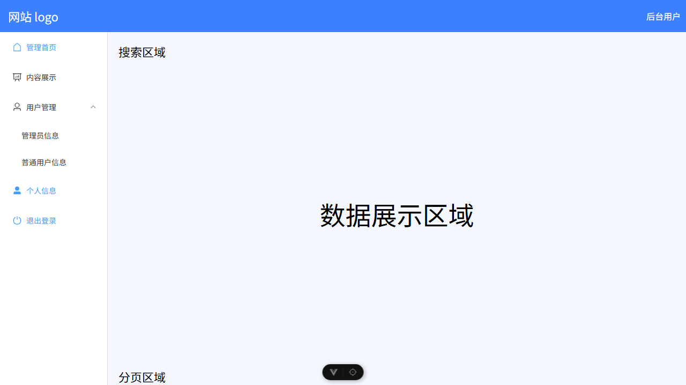
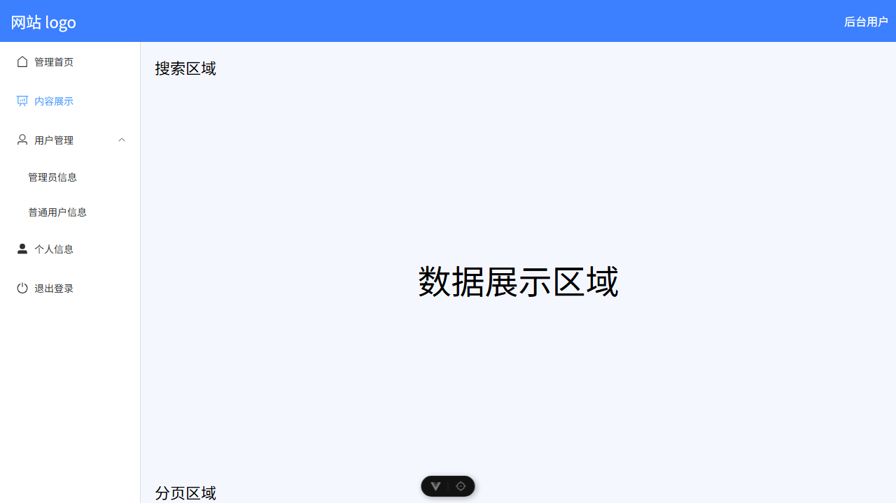
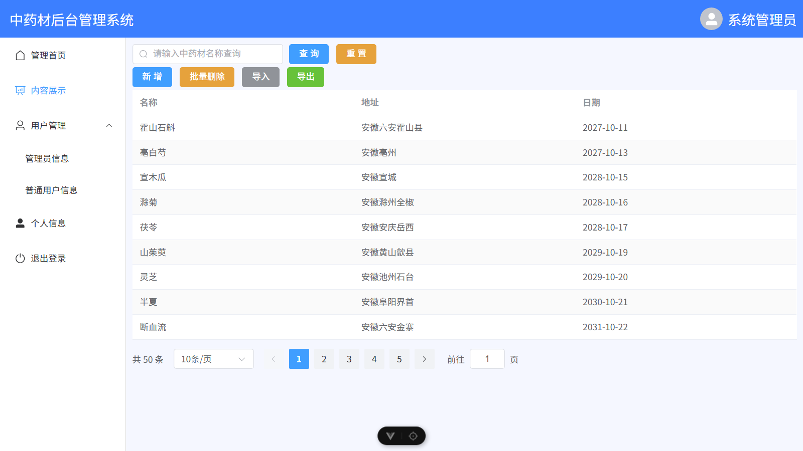
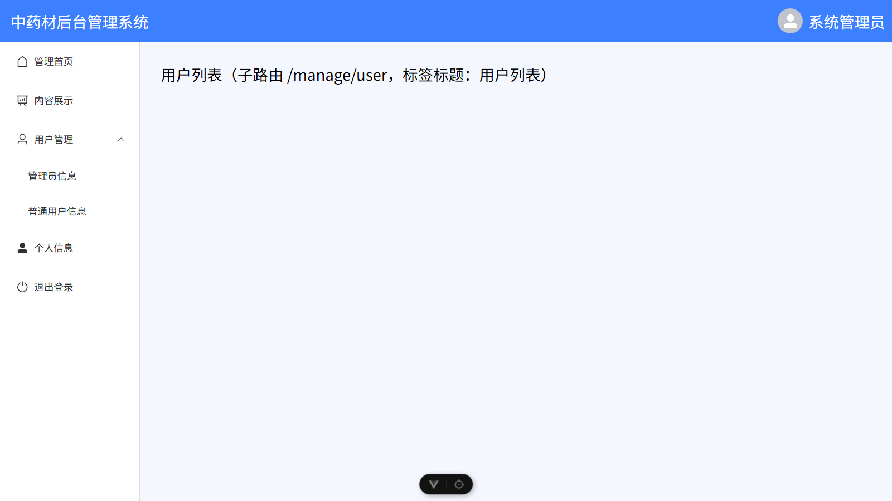
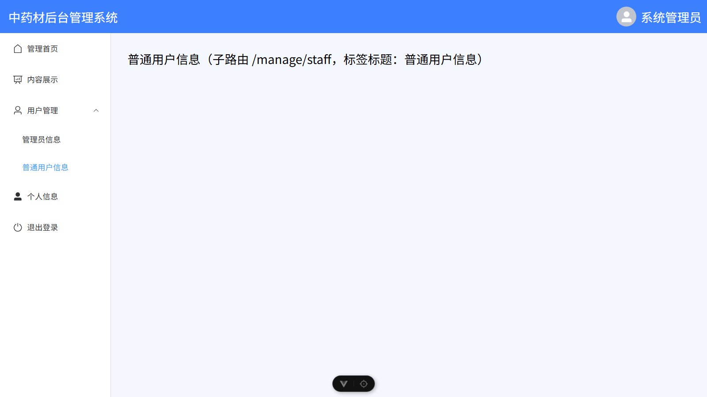
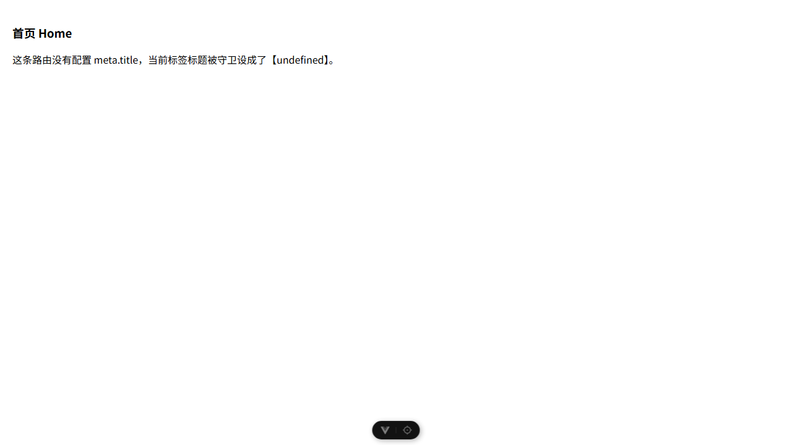
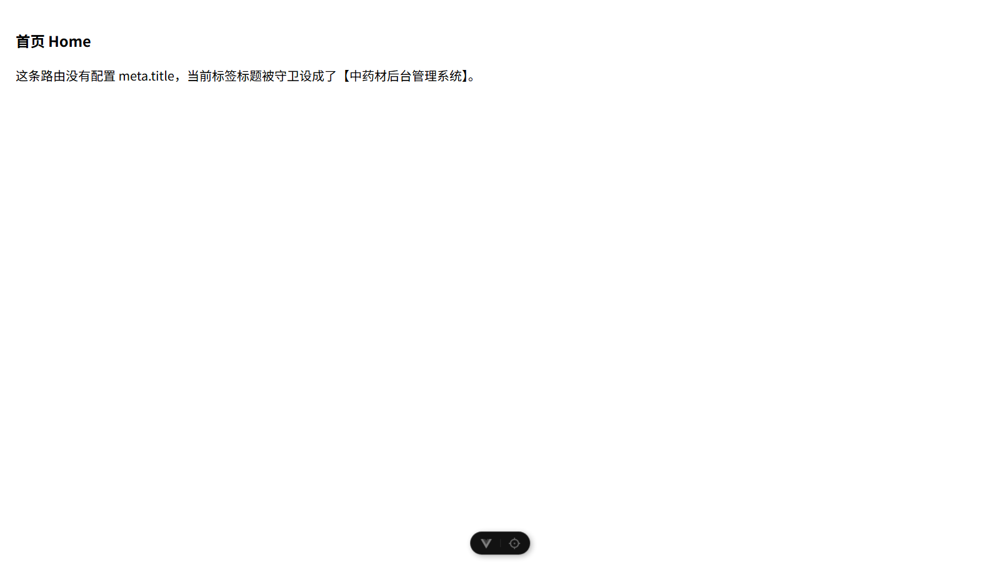

# 实训6 构建验证

工程在 `05/admin-layout`，按 `05/实训6__后台管理页面.pdf` 逐条复刻：Manage.vue 后台父页面布局、Detail.vue 内容展示子页面、router/index.js 嵌套路由与全局守卫。

配套讲解页：**`知识点讲解_实训6.html`**（双击即开，无外部依赖）。里面有六个知识点精讲、7 条实测问题清单、以及作业"三、实验过程"那一栏的逐项对照写法。

## 怎么跑

```
cd 05/admin-layout
npm install
npm run dev
```

浏览器打开 `http://localhost:5173/manage/detail`。`npm run build` 已通过（vite 8.2.2，614ms）。

依赖：vue 3.5.42、vue-router 5.3.1、element-plus 2.14.7、@element-plus/icons-vue 2.3.2。

## 与讲义的差异（工程里保留的是修正版）

| # | 讲义写法 | 实测现象 | 工程处理 |
|---|---|---|---|
| 1 | Manage.vue 全文没有 `<router-view />` | `/manage` 与 `/manage/detail` 两张截图完全相同，右侧停在"数据展示区域"占位，Detail 从未渲染 | 右侧内容区改为 `<router-view />` |
| 2 | 子菜单两项 `<el-menu-item>` 没有 `index` | 点击后地址栏不变、页面无反应，控制台两条 `[Vue warn]: Missing required prop: "index"` | 补 `index="/manage/admin"`、`/manage/staff` 及对应子路由 |
| 3 | 管理首页、个人信息、退出登录三项 index 都写 `/manage` | 停在 `/manage` 时三条菜单同时高亮 | 保留讲义写法，另加 `{ path:'', redirect:'/manage/detail' }` 避免右侧空白 |
| 4 | 守卫 `document.title = to.meta.title` | 访问无 meta 的 `/home` 时标签页显示 `undefined` | 改为 `to.meta.title \|\| '中药材后台管理系统'` |
| 5 | `detail` 子路由未配 meta | 标签页显示"后台管理"（父级标题），**不是** undefined：vue-router 会合并父子 meta | 补 `meta:{title:'内容展示'}` |
| 6 | 守卫用第三个参数 `next()` | 每次导航控制台报 `[VUE_ROUTER_R0025] next() is deprecated`（vue-router 5 已废弃） | 保留 `next()` 以与讲义、报告一致 |
| 7 | 头部文字"网站 logo""后台用户" | 与讲义第 2 页目标界面图不符（图里是"中药材后台管理系统"+ 头像 + "系统管理员"） | 按图实现 |

另外 `total: 50` 而 `tableData` 只有 9 条、也没按 `pageNum` 切片：实测点第 2 页后页码高亮变了但 9 行数据不变。讲义要求的是"完成分页 UI 展示"，故保留原样，切片写法见讲解页知识点 5。

## 截图

原版（讲义字面代码）与修正版对照：

| 说明 | 图 |
|---|---|
| 原版 `/manage`，三块占位 |  |
| 原版 `/manage/detail`，与上一张相同 = Detail 没渲染 |  |
| 修正后 `/manage/detail`，与讲义目标界面一致 |  |
| 子路由 `/manage/user` 渲染进右侧内容区 |  |
| 子菜单跳转 `/manage/staff` 并正确高亮 |  |
| 原版守卫下 `/home` 标签标题为 undefined |  |
| 加兜底后同一路径显示默认标题 |  |

讲义原图（取自 pdf 第 2、9 页）在 `勘误图/`。截图均为 Edge 无头浏览器实拍，1280×720、1.25 缩放，与讲义目标图同一口径。
