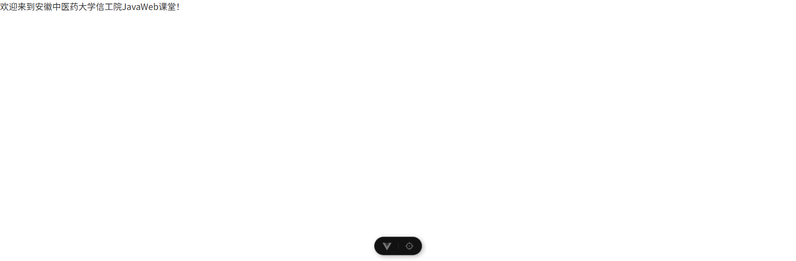

# 实验过程 实训1：软件安装及创建 Vue 项目

> 用法：下面每一节对应作业里的一条要求。文字可以直接抄进答题框（建议改成自己的话），图片按标注的文件名上传。
> 工程目录：`实训1_软件安装及创建Vue项目/工程/hello-vue`。本讲是整个课程的第一讲，后面五讲都在这个工程骨架上继续加东西。

## 0. 实验环境

| 项目 | 本机实际值 |
|---|---|
| 操作系统 | Windows 11 (10.0.26200) |
| Node.js | v24.17.0 |
| npm | 11.13.0 |
| 镜像源 | `http://registry.npmmirror.com` |
| 开发工具 | IntelliJ IDEA 2025 |

说明：讲义要求装 Node 20，本机因为之前已经装过更高版本，直接用现有的 24 也能跑通本讲全部内容（`create-vue` 要求的版本区间是 `^20.19 \|\| >=22.12`，24 满足）。

## 1. Node.js 软件安装与环境验证

操作步骤：

1. 双击 `node-v20.15.1-x64.msi`（或官网下载的其它版本安装包），安装路径用默认值，一路 Next。
2. 安装完打开命令提示符（Win+R 输入 `cmd`），验证 Node 本体：

```
node -v
```

输出版本号（本机 `v24.17.0`）说明安装成功、且自动写进了系统 PATH。

3. 验证 npm。npm 是 Node 内置的包管理工具，跟着 Node 一起装好，不用单独安装：

```
npm -v
```

4. 配置国内淘宝镜像，解决从国外源下载依赖慢的问题：

```
npm config set registry http://registry.npmmirror.com
npm config get registry
```

第二条命令回显出刚设置的地址即生效。

截图：终端里 `node -v`、`npm -v`、`npm config get registry` 三条命令与回显各截一张。

遇到的问题与解决：

- 讲义里写的是 `http://registry.npmmirror.com`，现在这个域名已经不支持 http 明文访问，实测用 `https://registry.npmmirror.com` 更稳妥。两种写法都能装下依赖，只是 http 会多一次重定向。
- 如果 `node -v` 提示"不是内部或外部命令"，是 PATH 没写上，重装时勾上 Add to PATH，或手动把 Node 安装目录加进环境变量后重开命令行窗口。

## 2. 使用 Vite 创建 Vue3 工程

操作步骤：

1. 打开 Vue 官网 `https://cn.vuejs.org/`，复制"开始使用"里的脚手架命令。
2. 在资源管理器里新建练习目录（讲义用的是 `D:\my-project\xm-pro`），进入该目录后在地址栏输入 `cmd` 回车，在当前目录打开命令行。
3. 执行创建命令：

```
npm create vue@3.21.0
```

4. 按提示依次选择：项目名称 `vue`；不使用 TypeScript；只启用 Router；不启用试验特性；创建空白项目。
5. 依次执行三条初始化命令并启动：

```
cd vue
npm install
npm run dev
```

6. 终端出现下面这段输出，说明开发服务器起来了：

```
  VITE v7.3.6  ready in 644 ms

  Local:   http://localhost:5171/
  Vue DevTools: Open http://localhost:5171/__devtools__/ as a separate window
```

（本机 5173 端口被另一个工程占着，所以这里显示的是 5171；端口不同不影响结果。）

7. 复制 `http://localhost:5173/` 在浏览器打开，能看到 Vue 欢迎页。关掉命令行窗口，这个地址就访问不了了，因为服务器是命令行里跑着的进程。

截图：脚手架问答界面、三条命令执行过程、浏览器打开后的页面，各一张。

遇到的问题与解决：

- 本机 `npm create vue@3.21.0` 跑出来的是新版交互式界面：先问项目名称，然后给一个合并的勾选清单（TypeScript、JSX、Router、Pinia、Vitest、端到端测试、Linter、Prettier），和讲义截图里分三问答的样子不一样。等价操作是**只勾 Router，其余全部留空**，用方向键移动、空格勾选、回车确认。
- 选了"跳过示例"之后，脚手架给的是最简骨架：`App.vue` 是一句占位文字，`router/index.js` 的 `routes` 是空数组，而且**没有** `assets`、`components`、`views` 这三个目录。所以第 4 步的建目录和填代码是必做项，不做的话页面和路由表都是空的。
- `npm install` 时如果报 EBADENGINE 警告，是当前 Node 版本不在 `package.json` 的 `engines` 区间内，换用 20.19 以上或 22.12 以上的版本即可，警告本身不阻断安装。

## 3. IDEA 打开 Vue 项目

操作步骤：

1. IDEA 里 `File` 菜单选 `Open`，直接选中上一步创建的 `vue` 工程目录（不是选父目录 `xm-pro`），作为项目根打开。前后端混合的目录也能识别，IDEA 会把打开的这个目录当工程根。

   > **注意（与实训7 讲义对照）**：这一步是**只有前端**时的做法。到了实训7，`xm-pro` 下面同时有了 `springboot` 和 `vue`，实训7 讲义图 2 就要求打开 **`xm-pro` 整层**，好让左边同时列出后端和前端两个模块。两处是课程阶段不同导致的工程根变化，不冲突——只做前端时开 `vue`，前后端都在了开 `xm-pro`。详见 `实训7_新建SpringBoot项目/实验过程_实训7.md` 的"附-1"和"附8 第 9 条"。
2. 等右下角的索引和依赖下载走完。
3. 删除与本课程无关的示例文件：`.vscode` 目录、`README.md`、`.gitignore`，以及 `components` 里脚手架自带的示例组件，把 `src` 精简成干净骨架。
4. 运行项目：在 IDEA 底部 `终端` 里执行 `npm run dev`；或者用运行配置，点工具栏的绿色三角。
5. 浏览器访问终端里给出的 `http://localhost:5173`。

截图：IDEA 打开工程后的项目树、运行窗口输出。

遇到的问题与解决：

- 看不见运行按钮的绿色三角，通常是 IDEA 旗舰版没激活，或者没有用管理员身份启动；这时改用 IDEA 内置终端跑 `npm run dev` 效果完全一样。

## 4. 完善 Vue 项目目录与基础代码配置

这一步是作业的重点，7 个小条逐条对应：

**（1）在 src 下新建 assets、components、views 三个目录**

在 `src` 上右键，选"新建目录"，分别命名 `assets`、`components`、`views`。同时把老师发的 `logo.svg` 复制到 `assets` 下。

**（2）把页面组件 Home.vue 放到 views 目录**

内容就是最简的一个模板：

```vue
<template>
  <div>
    欢迎来到安徽中医药大学信工院JavaWeb课堂！
  </div>
</template>

<script setup>
</script>
```

**（3）修改路由配置文件 router/index.js，精简路由**

```js
import { createRouter, createWebHistory } from 'vue-router'

const router = createRouter({
  history: createWebHistory(import.meta.env.BASE_URL),
  routes: [
    { path: '/', name: 'home', component: () => import('../views/Home.vue') },
  ],
})

export default router
```

**（4）精简 App.vue，只保留路由视图**

```vue
<template>
  <RouterView />
</template>
```

**（5）在 assets 下新建全局样式文件 global.css**

```css
body {
    margin: 0;
    padding: 0;
    font-size: 14px;
    color: #333;
}
```

**（6）在 main.js 中引入全局样式文件**

```js
import { createApp } from 'vue'
import App from './App.vue'
import router from './router'
import '@/assets/global.css'

const app = createApp(App)

app.use(router)

app.mount('#app')
```

`@` 是指向 `src` 的路径别名，在 `vite.config.js` 的 `resolve.alias` 里配好了，所以 `@/assets/global.css` 等价于 `./assets/global.css`。

**（7）重启项目，浏览器验证页面显示效果**

见下一节。

截图：本讲每条都要配图，目录结构这张最省事——参照 `讲义截图/讲义_第四部分目标目录结构.png`（老师讲义原图，标号 1 是 assets 加 logo.svg、2 是 components、3 是 views 加 Home.vue），自己在 IDEA 里截一张同样结构的即可。

## 5. 第四部分第 8 条的截图（作业特别点名要的那张）

讲义第 8 条是"重新运行一下项目"，老师给的图不是浏览器页面，而是 **IDEA 左下角"运行"面板里那个绿色重启按钮**，旁边还带着终端输出的 `Vue DevTools: Open http://localhost:5173/...` 那几行。参照图我存在了 `实训1_软件安装及创建Vue项目/讲义截图/讲义_第8条_IDEA重新运行.png`。

这张必须你在 IDEA 界面里截，具体动作：

1. 打开 IDEA 底部的"运行"窗口（第一次要先在终端跑一次 `npm run dev` 生成运行配置）。
2. 点运行窗口左上角那个绿色圆形重启按钮（讲义图里用红框和"点这里，重新运行"标出来的位置）。
3. 下方输出区重新滚出 `VITE ... ready in xxx ms` 和 `Local: http://localhost:5173/` 时，连按钮带输出区一起截屏。

## 6. 本讲三个文件各自的作用（实验小结里常被追问）

| 文件 | 作用 |
|---|---|
| `index.html` | 真正的单页入口，里面只有一个 `<div id="app">` 和一行 `<script src="/src/main.js">` |
| `src/main.js` | 项目入口脚本：创建应用实例、挂路由插件、引全局样式、挂载到 `#app` |
| `src/App.vue` | 根组件，被挂进 `#app`，里面只放 `<RouterView />`，页面内容由路由决定 |

注意：讲义正文里把 App.vue 叫"入口文件"，严格说入口是 `main.js`，App.vue 是根组件。考试时按讲义口径写没问题，但要清楚两者区别。

## 7. 运行结果

`npm run dev` 后浏览器访问 `http://localhost:5173/`，页面显示"欢迎来到安徽中医药大学信工院JavaWeb课堂！"，文字紧贴浏览器左上角（说明 global.css 里 `margin: 0; padding: 0` 生效了），字号 14px、颜色 #333。


