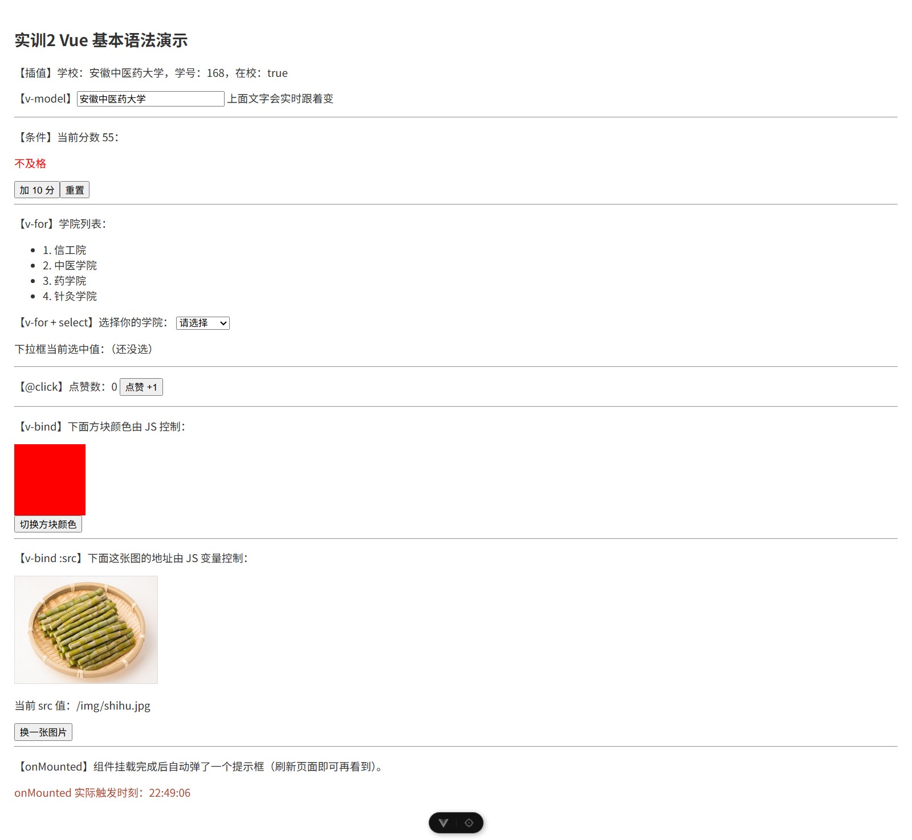

# 实训2 构建验证（vue-syntax）

> 实跑记录：2026-10-20 在本机真实执行 `npm run build` / `npm run dev`，并用无头 Chrome（CDP）逐点断言 DOM + 真实点击/输入验证响应式，不是"看起来没问题"。
> 截图在 `.extract/verify/shots/`（本地过程目录，`.extract/` 已被 `.gitignore` 忽略，不入库）。

## 0. 工程与环境

| 项 | 值 |
| --- | --- |
| 工程路径 | `实训2_Vue基本语法/工程/vue-syntax` |
| package.json | `name:"vue"`，`vue ^3.5.42`、`vue-router ^5.3.1`、`vite ^8.2.2`、`@vitejs/plugin-vue ^6.0.8`、`vite-plugin-vue-devtools ^8.2.1` |
| 实际安装 | vite 8.3.1 |
| 页面 | 只有一条路由 `/` → `src/views/Home.vue`（`App.vue` 只有 `<RouterView />`） |
| 依赖 | `node_modules` 已存在，本次**没有重装依赖** |

## 1. `npm run build`

```
> vue@0.0.0 build
> vite build

vite v8.3.1 building client environment for production...
transforming...
✓ 25 modules transformed.
dist/index.html                  0.42 kB │ gzip:  0.28 kB
dist/assets/index-Dz-4Z45z.css   0.05 kB │ gzip:  0.07 kB
dist/assets/Home-69006V0w.js     3.05 kB │ gzip:  1.66 kB
dist/assets/index-DlEVTLL4.js   89.62 kB │ gzip: 34.78 kB

✓ built in 914ms
```

- 退出码 `0`，**无编译告警、无体积告警**。
- `public/img/{shihu,juhua}.jpg` 被原样拷到 `dist/img/`（`dist\img\shihu.jpg 87110`、`dist\img\juhua.jpg 79863`），所以 `:src="/img/shihu.jpg"` 在构建产物里同样有效。

## 2. `npm run dev` + 九个语法点逐点实测

命令：`npm run dev -- --port 5172 --strictPort` → `Local: http://localhost:5172/`（同样只监听 `[::1]`，必须用 `localhost`）。

### 2.1 首屏九点断言（`http://localhost:5172/?noalert=1`）

| # | 语法点 | 页面可见证据（实测 innerText / 计算样式） | 判定 |
| --- | --- | --- | --- |
| 1 | 插值 `{{ }}` | `【插值】学校：安徽中医药大学，学号：168，在校：true` | ✅ |
| 2 | `reactive` | 上面这行的 school/no/ok 全部来自 `reactive({school,no,ok,colleges,myCollege,imgUrl})`，改输入框后整行跟着变（见 2.2） | ✅ |
| 3 | `ref` | `【条件】当前分数 55`（`score=ref(55)`）、`点赞数：0`（`count=ref(0)`），点击后 DOM 立即更新 | ✅ |
| 4 | `v-model` | 输入框初值 `安徽中医药大学`，与插值行一致；输入后插值行同步（见 2.2） | ✅ |
| 5 | `v-if / v-else-if / v-else` | 初态渲染 `不及格`（`score=55`），实测三态互斥：只有 1 个 `<p>` 出现 | ✅ |
| 6 | `v-for` | `<ul>` 里 4 个 `<li>`：`1. 信工院 / 2. 中医学院 / 3. 药学院 / 4. 针灸学院`；`<select>` 里 `请选择 + 4 个 <option>` | ✅ |
| 7 | `@click` | `【@click】点赞数：0` → 点 3 次后 `点赞数：3` | ✅ |
| 8 | `v-bind`（`:style` / `:src`） | 方块 `100×100px background rgb(255,0,0)`；`` `naturalWidth=800` 图片真的加载出来 | ✅ |
| 9 | `onMounted` | 页面可见 `onMounted 实际触发时刻：22:36:18`（与检查时刻差 1 秒）；控制台真的打印 `Home.vue 加载完成！`；不带 `?noalert=1` 时**真的弹出 alert**：CDP 捕获 `{type:"alert", message:"页面加载完成，onMounted 钩子已触发"}` | ✅ |

### 2.2 真实交互验证（无头 Chrome 里点按钮 / 敲输入框）

| 操作 | 操作前 | 操作后 | 判定 |
| --- | --- | --- | --- |
| 输入框输入 `测试输入学院` | `学校：安徽中医药大学` | `学校：测试输入学院` | ✅ v-model 双向生效 |
| 点「加 10 分」×4 | 分数 55 / `不及格` | 分数 95 / `优秀` | ✅ v-if 三态真的会切 |
| 点「重置」 | 分数 95 / `优秀` | 分数 55 / `不及格` | ✅ |
| 点「点赞 +1」×3 | 点赞数 0 | 点赞数 3 | ✅ @click 生效 |
| 点「切换方块颜色」 | `rgb(255,0,0)` | `rgb(0,0,255)` | ✅ `:style` 响应式 |
| 点「换一张图片」 | `/img/shihu.jpg` | `/img/juhua.jpg`（`naturalWidth=800`，图真的换了） | ✅ `:src` 响应式 |
| 下拉框选 `药学院` | `（还没选）` | `药学院` | ✅ select 的 v-model |

## 3. 页面质量断言

| 断言 | 实测 | 结论 |
| --- | --- | --- |
| 横向溢出 | `scrollWidth 1280 == innerWidth 1280`（差 0） | ✅ |
| 运行时异常 | CDP `Runtime.exceptionThrown` 0 条；Vite 错误浮层 0 个 | ✅ |
| 控制台输出 | 初始加载 3 条：`[vite] connecting...`、`[vite] connected.`、`Home.vue 加载完成！`；交互过程 0 条 warning/error | ✅ 干净 |
| 图片请求 | `shihu.jpg transferSize 87410`（真的走了网络，不是 404 占位） | ✅ |
| `global.css` | `body` 计算样式 margin 0 / padding 0 / 14px / `rgb(51,51,51)` | ✅ |
| 截图 | `.extract/verify/shots/02_shiXun2_full.png`（整页 1280×1153）、`02_shiXun2_after_interaction.png`（交互后） | — |

## 4. 与讲义核对

讲义 `实训2_Vue基本语法/讲义/实训2_Vue基本语法.docx` 是**概念 + 动图型讲义**：全文抽取只有 37 段文字（约 2 KB），配 7 个 GIF（`表单数据双向绑定01/02`、`条件语句03`、`循环04`、`单击事件05`、`v-bind动态绑定06`、`onMounted07`），**正文没有给出一行可复制的完整代码**。

所以「代码是否符合讲义」只能按语法点核对：

| 讲义章节 | 讲义讲了什么 | Home.vue 里的实现 | 判定 |
| --- | --- | --- | --- |
| `{{ }}` 双大括号 | 文本插值 | 第 6 行插值行 | ✅ |
| 一、数据绑定 | `ref` 基础类型 / `reactive` 对象数组 | `reactive`(L65)、`ref`(L75/78/99) 全用上 | ✅ |
| 二、v-model | 表单双向绑定 | 文本输入框(L9)、下拉框(L29) | ✅ |
| 三、v-if / v-else-if / v-else | 条件渲染 | L14-16 三态 + 两个按钮改分数 | ✅ |
| 四、v-for | 循环 | L24 `<li v-for>`、L31 `<option v-for>` | ✅ |
| 五、@click（v-on） | 单击事件 | L17/18/39 三个按钮 | ✅ |
| 五、v-bind | 动态绑定属性 | L45 `:style="box"`、L51 `:src="data.imgUrl"` | ✅ |
| 五、onMounted | 挂载完成后触发 | L100-106：`console.log` + 写 `mountedAt` + `alert` | ✅ |

- **`v-for` 是否带 `:key`**：带。两处分别是 `:key="index"`（L24）和 `:key="c"`（L31）。用下标当 key 是常见写法，本页数据不重排所以没副作用；如果要严格，建议改成数据本身的唯一值。
- **代码 vs 讲义的差异（1 处）**：`onMounted` 里多了个开关 —— `if (!new URLSearchParams(location.search).has('noalert'))` 才 `alert()`，即 `?noalert=1` 可跳过弹窗。这是为了无头浏览器截图不被阻塞加的实现细节（文件内注释已说明），**不带参数时行为与讲义一致**（实测真的弹了 alert）。
- **出处不一致（1 处）**：`Home.vue` 注释里引用「作业 2.4 / 2.6.2 / 2.6.3 要求」，但**讲义 docx 全文没有"作业"字样**，也没有这些编号。这些编号应来自课程网站/课堂口头布置，讲义正文里查不到。若 errata 要引用，请注明"作业编号不在 docx 正文中"。
- 页面标题 `<h2>实训2 Vue 基本语法演示</h2>` 与页面结构是自拟的（讲义没有页面代码），不影响语法点核对。

## 5. 三段结论

| 维度 | 结论 |
| --- | --- |
| ① 工程能不能跑 | **能**。build exit 0（914 ms，25 modules，无告警）；dev 页面正常渲染，九个语法点全部可见且可交互，0 运行时异常，无横向溢出。 |
| ② 代码是否符合讲义 | **符合（语法点全覆盖）**。讲义 8 个小节 / 9 个语法点（插值、ref、reactive、v-model、v-if、v-for、@click、v-bind、onMounted）在页面上都有独立、可见、可交互的效果；`v-for` 带 `:key`。仅 onMounted 多了一个 `?noalert=1` 截图开关（默认行为不变）。 |
| ③ 讲义本身对不对 | **没有事实性错误**，但它不是"可照做"的讲义：只讲概念 + 放动图，没有一份能直接运行的代码清单，学员照着讲义抄不出本页。「作业编号」（2.4/2.6.2/2.6.3）在讲义正文中不存在。 |

## 6. 复现命令

```powershell
cd 实训2_Vue基本语法\工程\vue-syntax
npm run build                                   # 约 0.9s，exit 0
npm run dev -- --port 5172 --strictPort         # http://localhost:5172/
# 想跳过 onMounted 的 alert：http://localhost:5172/?noalert=1
```


