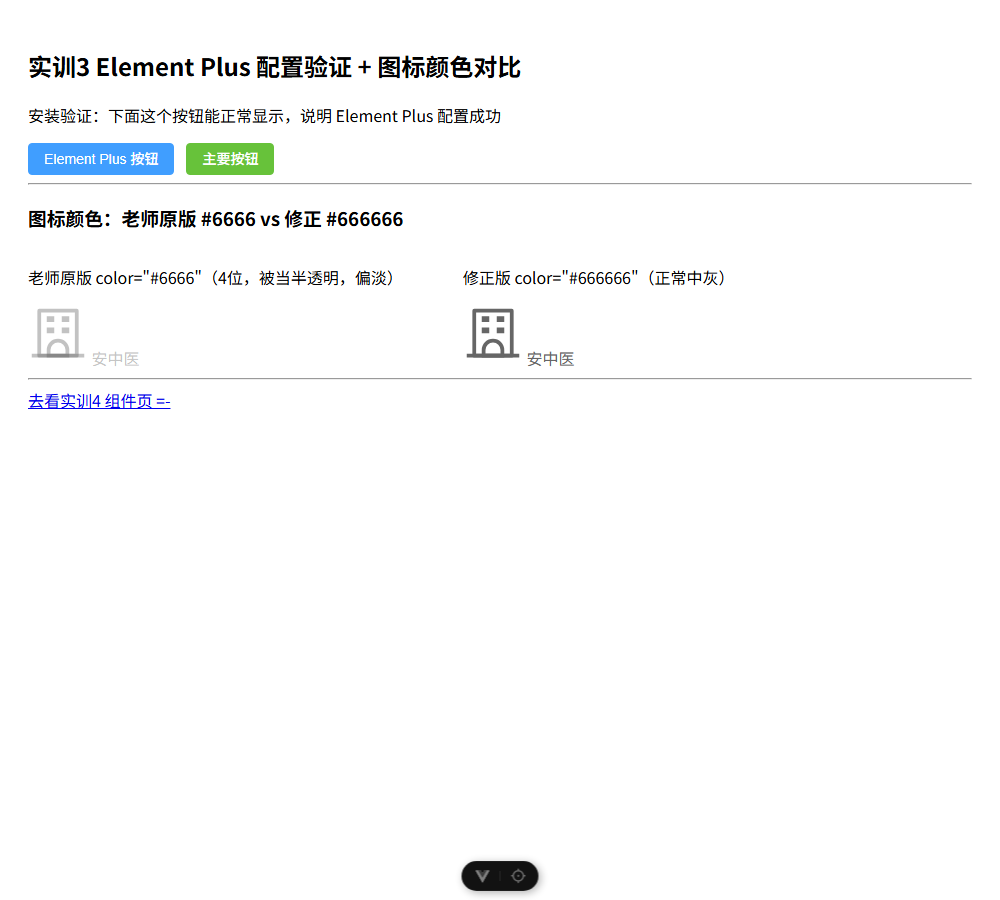
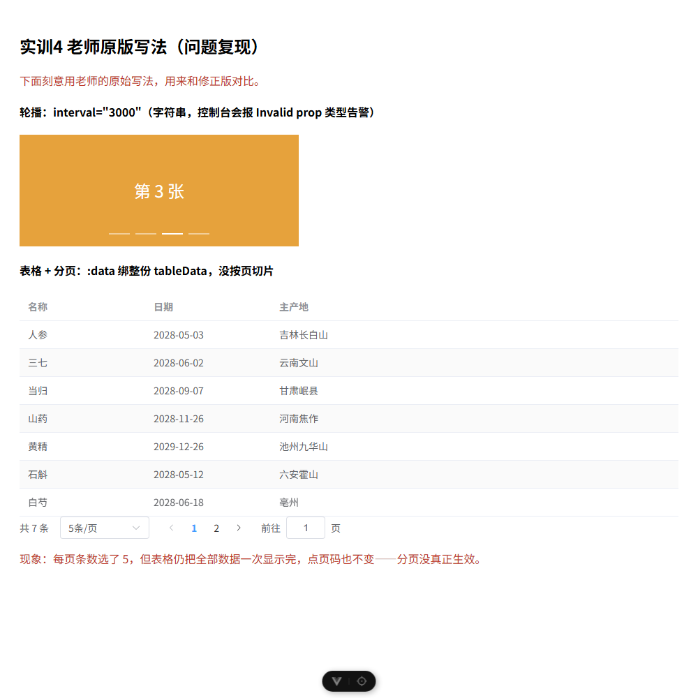
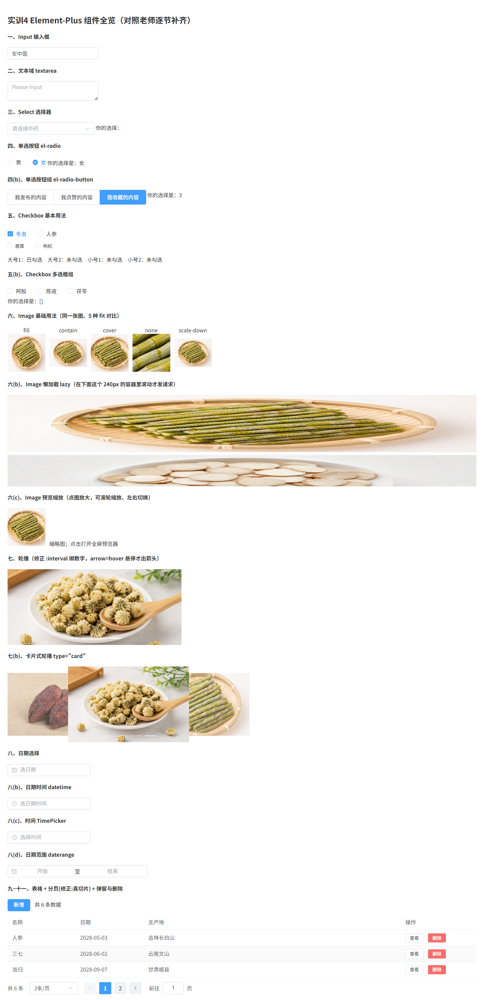

# 实训3 + 实训4 构建验证（element-plus 工程）

> 实跑记录：2026-10-20 在本机真实执行 `npm run build` / `npm run dev`，用无头 Chrome（CDP）打开 `/home`、`/comp`、`/comp-orig` 三个路由做 DOM 断言、真实点击，并**抓取 Vue 控制台告警 + 读取 Vite 编译产物**来判定讲义原版与修正版的差异是否真的存在。
> 截图在 `.extract/verify/shots/`（本地过程目录，`.gitignore` 忽略 `.extract/`，不入库）。

## 0. 工程与环境

| 项 | 值 |
| --- | --- |
| 工程路径 | `实训3_前端ElementPlus框架/工程/element-plus`（**实训4 复用同一个工程**） |
| 依赖 | `element-plus ^2.14.6`（实际 2.14.6）、`@element-plus/icons-vue ^2.3.2`、`vue ^3.5.42`、`vue-router ^5.3.1`、`vite ^8.2.2`（实际 8.3.1） |
| 路由 | `/` → redirect `/home`；`/home`（实训3 配置验证）、`/comp`（实训4 修正版）、`/comp-orig`（实训4 老师原版复刻） |
| node_modules | 已存在，本次**没有重装依赖** |

## 1. `npm run build`

```
> vue@0.0.0 build
> vite build

vite v8.3.1 building client environment for production...
✓ 1595 modules transformed.
dist/index.html                                 0.42 kB │ gzip:   0.28 kB
dist/assets/index-Cs0q3ITg.css                360.14 kB │ gzip:  47.96 kB
dist/assets/Home-BLuZXXH5.js                    2.08 kB │ gzip:   0.96 kB
dist/assets/ComponentsOriginal-2eUYYed5.js      2.22 kB │ gzip:   1.38 kB
dist/assets/Components-CU9Uf-m5.js             10.08 kB │ gzip:   3.98 kB
dist/assets/index-DYz6qypX.js               1,157.47 kB │ gzip: 363.87 kB

✓ built in 5.67s
[exit=0]
```

- 退出码 `0`，**Vue 编译无错误**。
- **有 1 条体积告警**（不影响运行，但值得写进教学说明）：
  ```
  (!) Some chunks are larger than 500 kB after minification.
  - dist/assets/index-DYz6qypX.js   1,157.47 kB │ gzip: 363.87 kB
  ```
  原因就是讲义的做法：`app.use(ElementPlus)` **全量引入** + `for (...)` **全局注册全部图标**，导致无法 tree-shaking，主 chunk 1.16 MB、CSS 360 KB。这不是 bug，是"全量注册"的代价（真做项目应改用按需自动导入 unplugin-vue-components）。

## 2. 实训3：`/home` 配置验证（实测）

命令：`npm run dev -- --port 5173 --strictPort` → `Local: http://localhost:5173/`（同样只监听 `[::1]`，必须用 `localhost` 访问，`127.0.0.1` 连不上）。

| 断言 | 实测值 | 判定 |
| --- | --- | --- |
| `/` 重定向 | `location.pathname == /home` | ✅ 路由 redirect 生效 |
| Element Plus 是否装上 | 10 个 `.el-button` 全部渲染，文案 `默认按钮/主要按钮/成功按钮/警告按钮/危险按钮/信息按钮/plain 朴素/round 圆角/disabled 禁用/link 链接` | ✅ |
| 主色是否正确 | `.el-button--primary` 计算样式 `background-color: rgb(64,158,255)`、`color: rgb(255,255,255)`、`border-radius: 4px` | ✅ EP 样式表真的加载了 |
| 变体/禁用 | plain 按钮 class = `el-button el-button--primary is-plain`；禁用按钮 `disabled=true` | ✅ |
| 图标是否真的渲染 | 2 个 `.el-icon`，内部 `<svg>` 各 3 个 `<path>`，盒子 `60×60 px`（`:size="60"` 生效） | ✅ `<School />` 能渲染 |
| `color="#6666"`（老师原版） | `.el-icon` 的 inline style = `font-size: 60px; --color: #6666;`；计算色 **`rgba(102, 102, 102, 0.4)`** | ✅ 4 位十六进制 = #RGBA → **半透明灰** |
| `color="#666666"`（修正版） | inline style = `font-size: 60px; --color: #666666;`；计算色 **`rgb(102, 102, 102)`** | ✅ 正常中灰 |
| 外层 `<span style="color:#6666">` | 计算色同样是 `rgba(102,102,102,0.4)` → 文字也一起变淡 | ✅ 截图里"图标+文字"都浅 |
| 横向溢出 | `scrollWidth == innerWidth == 1280`（差 0） | ✅ |
| 运行时异常 | CDP `Runtime.exceptionThrown` 0 条；控制台无 warning | ✅ |
| 截图 | `.extract/verify/shots/03_shiXun3_home.png` | — |

**中文语言包（`zhCn`）实测生效**：

| 证据 | 实测文本 |
| --- | --- |
| 分页（实训4 `/comp`） | `.el-pagination__total` = **`共 6 条`**；`.el-pagination__jump` = **`前往 页`**；每页条数 = **`3条/页`** |
| 日期面板（点开 `/comp` 第一个日期框） | 表头 **`2026 年` / `10 月`**，星期表头 **`日 一 二 三 四 五 六`** |
| 默认 checkbox/radio 文案 | 组件内置文案均为中文 |

（对照 `node_modules/element-plus/es/locale/lang/en.mjs`：`total: "Total {total}"`、`goto: "Go to"`、`pagesize: "/page"`，日期面板月份/星期也是英文 —— 所以上面这些中文文本确实是 `zhCn` 在起作用，不是组件自带中文。）

**`app.use(ElementPlus)` 顺序**：`src/main.js` 实测为 `createApp(App)`（L12）→ `app.use(router)`（L14）→ `app.use(ElementPlus, { locale: zhCn })`（L16）→ 注册图标（L19-21）→ `app.mount('#app')`（L23）。顺序正确（先 createApp 再 use，mount 最后），与讲义 `讲义/资源/main.js` 的顺序语义一致（讲义把 `global.css` 放在 EP css 之后，工程放在之前；实测 `body` 仍是 `margin 0 / 14px / rgb(51,51,51)`，结果无差异）。

**图标一处小差（可忽略）**：讲义代码给图标加了 `style="top: 4px"`，而 `.el-icon` 实测 `position: relative` —— 所以讲义那 4px **确实会生效**（图标比工程版低 4px）。工程的 `Home.vue` 删掉了这 4px，属于无害视觉微差。

## 3. 实训4 修正版：`/comp` 实测

| 断言 | 实测值 |
| --- | --- |
| 小节数 | 17 个 `<h4>`，id 从 `s1` 到 `s9`（含 s4b/s5b/s6b/s6c/s7b/s8b/s8c/s8d）→ 讲义"一~十一"全部对上 |
| 组件渲染计数 | `.el-button` 9、`.el-input` 7、textarea 1、`.el-select` 2、`.el-radio-group` 2、`.el-radio` 2、`.el-radio-button` 3、`.el-checkbox` 7、`.el-checkbox-group` 1、`.el-image` 14、`.el-carousel` **2**（普通 + `el-carousel--card`）、`.el-carousel__item` 8（4+4）、`.el-date-editor` 4（date/datetime/time/daterange）、`.el-table` 1、`.el-pagination` 1 |
| `el-image` 5 种 fit | 5 张图的 `object-fit` 依次为 `fill / contain / cover / none / scale-down`（真的各不相同） |
| 懒加载 `lazy` | 滚到容器底部前：容器内 `img` 2 张；滚动后：4 张（`/img/shihu.jpg`、`baishao.jpg` → 追加 `mugua.jpg`、`juhua.jpg`），`.el-image__placeholder` 4 个 → **确实是"进视口才加载"** |
| 轮播（`arrow="hover"`、`:interval="2000"`） | 2400 ms 内活动 slide 从 index 1 变成 2 → **真在自动轮播**；`.el-carousel--card` class 存在 |
| 分页 | `.el-pagination` class = **`el-pagination is-background`**（背景样式生效，分页按钮底色 `rgb(240,242,245)`）；total 文本 `共 6 条`；页码按钮 `1 / 2` |
| **分页真的切片** | 第 1 页表格 3 行：`人参 / 三七 / 当归`；点第 2 页后 3 行变成 `山药 / 黄精 / 石斛`，活动页高亮 `2` → **切片是真的** |
| 弹窗（新增，URL 加 `?open=add` 自动打开便于截图） | `.el-dialog` 可见，标题 `新增中药材`，表单项 `名称/日期/主产地`，底部按钮 `取消/保存`，3 个 input |
| 弹窗（查看，`?open=view`） | `.el-message-box` 可见，标题 `第 1 行`，正文 `名称 人参　日期 2028-05-03　主产地 吉林长白山`，按钮 `关闭` → ElMessageBox 可用 |
| 横向溢出 / 异常 | 溢出 0；`Runtime.exceptionThrown` 0；**控制台无任何 warning/error** |
| 截图 | `.extract/verify/shots/04_shiXun4_comp_full.png`（整页 1280×2647）、`04_shiXun4_dialog_add.png`、`04_shiXun4_messagebox_view.png` |

## 4. 关键：`/comp-orig`（老师原版复刻）与的对比 —— 差异**真的存在**，但方向和讲义描述有出入

打开 `http://localhost:5173/comp-orig` 后实测（这一页刻意照抄讲义写法）：

### 4.1 轮播 `interval="3000"`（字符串）

控制台**确实报警告**（CDP 捕获，原文）：

```
[Vue warn]: Invalid prop: type check failed for prop "interval".
Expected Number with value 3000, got String with value "3000".
  at <ElCarousel height="160px" style= Object autoplay=""  ... >
  at <ComponentsOriginal> ...
```

Vite 编译产物（`GET /src/views/ComponentsOriginal.vue` 解出来的 render 函数）也证实：

```js
_component_el_carousel, { height: "160px", style: {"width":"400px"}, autoplay: "", interval: "3000", "pause-on-hover": "", ... }
```

**但是功能没坏**：实测 3400 ms 后活动 slide 从 index 0 变成 1 —— 轮播照常 3 秒切一张。
原因在 element-plus 源码 `es/components/carousel/src/use-carousel.mjs`：

```js
if (props.interval <= 0 || !props.autoplay || timer.value) return;
timer.value = setInterval(() => playSlides(), props.interval);   // 字符串会被 setInterval 强制转数字
```

→ **准确的结论：`interval="3000"` 是"类型不规范 + 开发期会有 Invalid prop 告警"，不是"轮播坏掉"。** 修正版 `:interval="2000"`（编译产物 `interval: 2000`，数字）是正确写法且无告警，但**不能写成"不加冒号就不轮播"**。

### 4.2 分页 `:background`（讲义写法）—— 讲义这里写错了

控制台实测还捕获到第二条警告：

```
[Vue warn]: Property "background" was accessed during render but is not defined on instance.
  at <ComponentsOriginal> ...
```

编译产物证明原因：

```js
_component_el_pagination, { ..., "page-sizes": [5,10,15,50], background: _ctx.background, layout: "...", total: $setup.tableData.length }
```

- Vue 3.4+ 把 `:background`（冒号 + 无值）当作**同名简写**，等价于 `:background="background"`；实例里根本没有 `background` 变量 → `undefined`，还会打一条 warn。
- 实测 DOM：`.el-pagination` 的 class = `el-pagination`（**没有 `is-background`**），分页按钮底色 `rgb(255,255,255)`、整体背景 `rgba(0,0,0,0)` → **背景样式没生效**。
- 修正版 `Components.vue` 用的是**裸属性** `background`，编译成 `background: ""`（空字符串），Boolean prop 被转成 `true` → 实测 class = `el-pagination is-background`，按钮底色 `rgb(240,242,245)`。

**所以「布尔属性」的正确写法是裸写 `background`，反过来"加冒号"才是错的。** 这条和讲义"数字要加冒号"的规则正好相反，是本次实测新发现的讲义错误（讲义里 `:background` 共出现 3 处：第十节 1 处、第十一节 2 处，全都写错）。

### 4.3 分页没有任何切片 —— 讲义确实"假分页"

| 检查 | 实测 |
| --- | --- |
| 表格 `:data` | 编译产物 `data: $setup.tableData`（整份数组，没有 computed 切片） |
| 首屏行数 | 7 行全部显示（人参/三七/当归/山药/黄精/石斛/白芍），而"每页条数"显示 `5条/页` |
| 点第 2 页 | 行数 **仍然是 7 行**（只有页码高亮从 1 变 2），表格内容不变 |
| 分页总数 | `共 7 条`（这是对的） |
| 结论 | 讲义第十节"分页"只是把 `el-pagination` 摆上去，**没有任何 `tableData.slice()`**，页码/每页条数都是"点得动但没用"。修正版用 `computed pagedData = tableData.slice(...)` 才是真分页。 |

### 4.4 `:total=tableData.length`（不加引号）—— **完全没问题，旧勘误是错的**

讲义第十/十一节写的是 `:total=tableData.length`（属性值没加引号）。实测：

- 编译产物：`total: $setup.tableData.length`（正确求值成 7）
- 页面实际渲染：`共 7 条`，页码 `1 / 2` 正确

→ **HTML 的"无引号属性值"对 `tableData.length` 这种不含空格的表达式完全合法，Vue 也照常编译。不需要"补引号"。**
（本文件旧版本第 22 行曾把"`:total="tableData.length"`（补引号）"当成一处修正/勘误 —— **该说法不成立，已在本版撤回**。修正版之所以补引号只是编码习惯，不是修 bug。）

## 5. 与原版对比总表

| 讲义写法（`/comp-orig` 复刻） | 实测现象 | 修正版写法（`/comp`） | 实测现象 | 讲义这一处对不对 |
| --- | --- | --- | --- | --- |
| `interval="3000"` | 控制台 `Invalid prop: interval Expected Number, got String`；**轮播照常 3s 切换** | `:interval="2000"` | 无告警，正常轮播 | ⚠️ 写法不规范（有 dev 告警），但**不影响功能** |
| `:background` | `background=_ctx.background` → undefined；无 `is-background`；还有一条 Vue warn | `background`（裸属性） | `background: ""` → true；有 `is-background` | ❌ **讲义错**，应写裸属性 |
| `:data="tableData"` + `el-pagination` | 7 行全显示，翻页不变化 → 假分页 | `:data="pagedData"`（computed slice） | 第 1 页 3 行 / 第 2 页 3 行，真分页 | ❌ **讲义缺切片逻辑** |
| `:total=tableData.length`（无引号） | 正常：`共 7 条`、页码正确 | `:total="tableData.length"` | 正常 | ✅ **不用改** |
| `color="#6666"` | 计算色 `rgba(102,102,102,0.4)`（半透明，偏淡） | `color="#666666"` | `rgb(102,102,102)` | ✅ 讲义确实写成了 4 位色，修正正确 |
| `<el-icon style="top: 4px">` | `.el-icon` 是 `position:relative`，4px 真的生效 | 去掉了 `top:4px` | 图标高 4px | ⚠️ 无害差异（讲义不算错） |
| 第十一节标题「十一、弹窗」 | 代码里**没有任何 `el-dialog`/`ElMessageBox`**：只有一列 `{{scope.row}}`（把整行对象直接插值）和 `alert("删除id = ...")` | `el-dialog` + `ElMessageBox.confirm/alert` | 实测弹窗、确认框、消息提示都能用 | ❌ **讲义这节名不副实**（"弹窗"其实是 alert + 对象插值） |

另外两条环境相关的观察：

- 讲义图片全部用外链（`www.ahtcm.edu.cn/__local/...`、`fuss10.elemecdn.com/...`）。2026-10-20 实测这两类链接 **HEAD 仍返回 200**（`ahtcm` 88086 字节、`elemecdn` 127479 字节），所以现在照抄还能显示；但外链随时可能失效，本工程改用 `public/img/` 本地图更稳（`Components.vue:150-151`）。
- 讲义写"我的版本号是 `element-plus ^2.14.2`"，工程装的是 2.14.6，同一大版本，组件 API 一致（`el-radio value` / `el-checkbox value` 的新写法在两者都可用）。

## 6. 三段结论

| 维度 | 结论 |
| --- | --- |
| ① 工程能不能跑 | **能**。`npm run build` exit 0（5.67s，1595 modules）；有一条 chunk >500 kB 的体积告警（全量引入 Element Plus 的代价，非错误）。dev 下 `/`→`/home` 重定向正常，`/home`、`/comp`、`/comp-orig` 三页全部真实渲染，组件、图标、中文语言包、弹窗、分页切片、轮播、懒加载都实测有效，0 运行时异常、无横向溢出。 |
| ② 代码是否符合讲义 | **覆盖讲义全部 11 节组件**（17 个小节），并按"修正版"改了三处：轮播绑数字、分页用 computed 真切片、布尔属性用裸 `background`。其中"绑数字"属于规范化（原写法也能跑），"真切片"和"裸 `background`"是实质修正。与讲义的两处表述需要对齐：讲义是 `interval="3000"`（不是 2000）、`:total` 不加引号并不需要改。 |
| ③ 讲义本身对不对 | **有 4 处实质问题**：①第十/十一节 `:background` 写法错误（Vue 3.4+ 会被当同名简写，实测不生效还报警）；②第十节分页没有切片逻辑 → 假分页；③第七节 `interval="3000"` 是字符串，开发期报 `Invalid prop` 告警（但功能仍正常，讲义若声称"轮播不生效"则过头）；④第十一节标题"弹窗"但代码里没有 `el-dialog`/`ElMessageBox`，只有 `{{scope.row}}` + `alert()`。**1 处判断正确**：`color="#6666"` 确实是半透明 4 位色、修正为 `#666666` 合理。**1 处无需修**：`:total=tableData.length` 不加引号是合法的。 |

## 7. 复现命令与截图

```powershell
cd 实训3_前端ElementPlus框架\工程\element-plus
npm run build                                    # 约 6s，exit 0（有 1 条 chunk 体积告警）
npm run dev -- --port 5173 --strictPort          # http://localhost:5173/
#   /             -> 自动跳到 /home
#   /home         实训3 配置验证 + 图标颜色对比
#   /comp         实训4 修正版（17 小节）
#   /comp?open=add   自动打开"新增"弹窗（便于截图）
#   /comp?open=view  自动打开"查看"消息框
#   /comp?open=del   自动打开"删除确认"框
#   /comp-orig    老师原版写法（问题复现，控制台有 2 条 Vue warn）
```

本次实测截图（`.extract/verify/shots/`）：

| 文件 | 内容 |
| --- | --- |
| `03_shiXun3_home.png` | 实训3 `/home`：10 个按钮 + 两枚图标（左 `#6666` 明显偏淡，右 `#666666` 正常） |
| `03_shiXun3_datepicker_zh.png` | 打开日期面板：`2026 年 / 10 月 / 日一二三四五六`（中文包生效证据） |
| `04_shiXun4_comp_full.png` | `/comp` 整页 1280×2647：17 小节全部渲染，底部真实分页（`共 6 条`、`3条/页`、页码 1/2、灰色背景按钮） |
| `04_shiXun4_comp-orig_full.png` | `/comp-orig`：轮播到"第 3 张"（说明字符串 interval 也在自动播）、表格 7 行全显示而分页写着 `5条/页` |
| `04_shiXun4_dialog_add.png` / `04_shiXun4_messagebox_view.png` | 新增弹窗 / 查看消息框（讲义没有这两段代码，是本工程补的） |

仓库内展示图（已提交，供文档引用）：







> **一处保留的旧更正（2026-10-16）**：本文件旧稿曾写"图片用项目内本地 `assets/logo.svg`"，与实际不符 —— `Components.vue` 并没有引用 `assets/logo.svg`，它用的是 `public/img/` 下四张图：`shihu.jpg`、`baishao.jpg`、`mugua.jpg`、`juhua.jpg`（见 `Components.vue:150-151`）。`assets/logo.svg` 是实训1 骨架里留下的文件，跟本讲无关。
>
> **本次撤回的旧勘误（2026-10-20）**：旧稿把"分页 `:total` 补引号"列为修正项 —— 实测 `:total=tableData.length`（不加引号）完全正常（渲染出 `共 7 条`），**该"修正"不必要，已撤回**。
