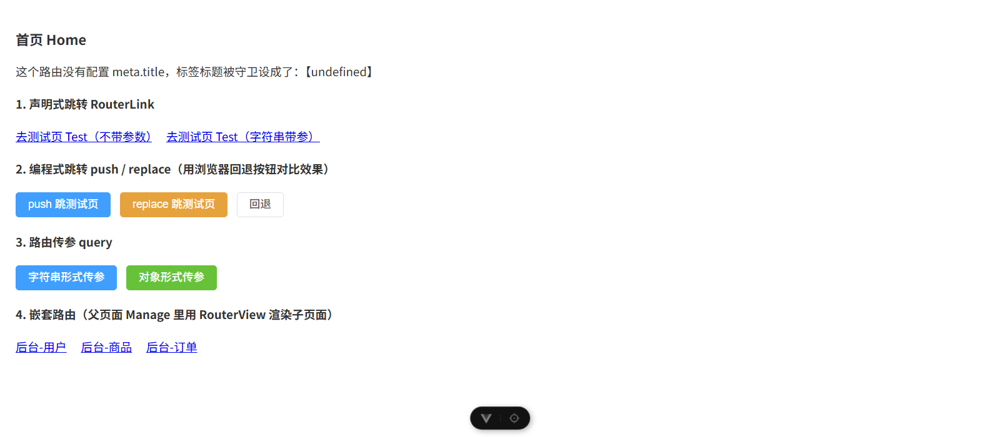
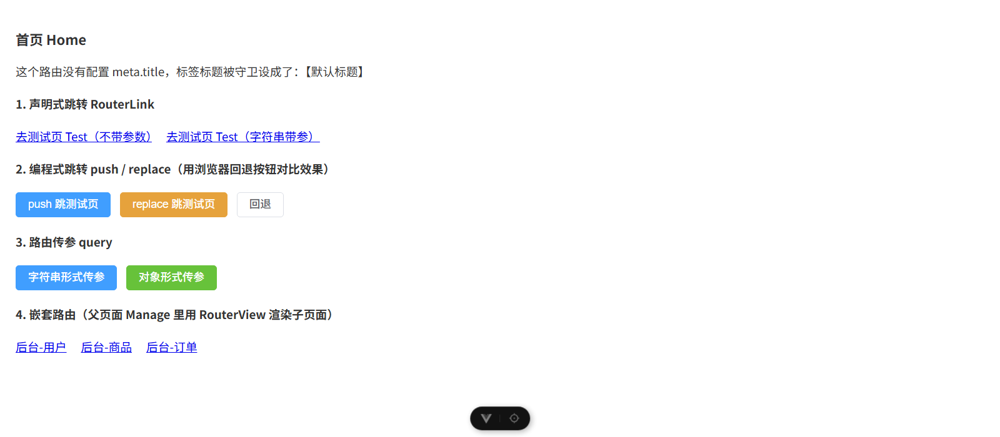

# 实验过程 实训5：Vue-Router 实现路由跳转

> 用法：每节对应作业的一条要求，文字可照抄（建议改成自己的话），图片按标注文件名上传。
> 工程目录：`实训5_Vue-Router实现路由跳转/工程/vue-router`。
> 本讲继承前三讲：工程骨架和 `views/Home.vue`、`router/index.js` 来自实训1；`Home.vue` 里演示用的跳转按钮是 `<el-button>`，所以本讲工程同样装了实训3 的 Element Plus。

## 0. 运行方式

```
cd 实训5_Vue-Router实现路由跳转/工程/vue-router
npm install
npm run dev
```

首页 `/home` 上排着本讲全部四类演示的入口，点一个跳一个。

## 1. 认识 Vue-Router 路由

Vue Router 是 Vue 官方的客户端路由方案。它做的事一句话：**把浏览器地址栏的 URL 和屏幕上显示的组件绑在一起**。

对比普通网站：点一个链接，浏览器刷新、转圈，从服务器重新下载一整个新页面。单页应用（SPA）不是这样，页面代码一开始就加载好了，路由切换只是换掉中间渲染的组件，地址栏变了但页面不整页刷新、不白屏。

核心文件是 `src/router/index.js`：

```js
import { createRouter, createWebHistory } from 'vue-router'

const router = createRouter({
  history: createWebHistory(import.meta.env.BASE_URL),
  routes: [
    { path: '/', redirect: '/home' },
    { path: '/home', name: 'home', component: () => import('../views/Home.vue') },
    { path: '/test', name: 'test', component: () => import('../views/Test.vue') },
  ],
})

export default router
```

`createRouter` 造路由实例，`createWebHistory` 指定用 HTML5 History 模式（地址栏是正常路径，不带 `#` 号）。`main.js` 里 `app.use(router)` 把实例挂到应用上，这一步不做，模板里写 `<RouterLink>` 也没反应。

截图：`演示截图/05_01_Home跳转入口.png`

## 2. 定义新路由

操作步骤：

1. 在 `src/views` 下新建 `Test.vue`。
2. 在 `routes` 数组里加一条规则，组件用懒加载方式导入：

```js
{ path: '/test', name: 'test', component: () => import('../views/Test.vue') }
```

`() => import(...)` 就是路由懒加载：访问到这条路由时才去下载对应组件的代码，而不是启动时把所有页面代码一次性加载完。

3. 在 `Home.vue` 里写跳转语句：

```html
<RouterLink to="/test">去测试页 Test（不带参数）</RouterLink>
```

4. 浏览器访问 `http://localhost:5173/test` 也能直接打开这个页面。

截图：`演示截图/05_01_Home跳转入口.png`，点进去之后配 `演示截图/05_02_声明式与字符串传参结果.png` 的上半部分。

## 3. 路由跳转练习

### 3.1 声明式跳转

```html
<RouterLink to="/test">去测试页 Test（不带参数）</RouterLink>
<RouterLink to="/test?id=123&name=手机">去测试页 Test（字符串带参）</RouterLink>
```

`RouterLink` 渲染出来就是一个 `<a>` 标签，`to` 指定目标地址。

### 3.2 编程式跳转 push 与 replace

```html
<el-button type="primary" @click="$router.push('/test')">push 跳测试页</el-button>
<el-button type="warning" @click="$router.replace('/test')">replace 跳测试页</el-button>
<el-button @click="$router.back()">回退</el-button>
```

模板里的 `$router` 是全局路由实例，`main.js` 执行 `app.use(router)` 之后 Vue Router 自动挂上来的，不用 import 就能用。在 `<script setup>` 里则要 `import router from '@/router/index.js'` 再用 `router.push(...)`。

**push 和 replace 的区别，用浏览器回退按钮验证：**

| 操作 | 历史记录 | 点浏览器回退 |
|---|---|---|
| `push('/test')` | 压入一条新记录 | 能退回上一页 |
| `replace('/test')` | 把当前这条替换掉 | 退不到被替换掉的那一页 |

实验步骤：从 `/home` 用 push 进 `/test`，点回退，回到 `/home`；再从 `/home` 用 replace 进 `/test`，点回退，直接跳出了这两个页面（因为 `/home` 那条记录被替换掉了）。

截图：`演示截图/05_01_Home跳转入口.png` 里那两个按钮；回退差异建议用连续两张（跳转前地址栏、回退后地址栏）。

### 3.3 redirect 重定向（默认路由）

```js
{ path: '/', redirect: '/home' }
```

在地址栏只输到根路径 `http://localhost:5173`（不带任何后缀），会自动跳到 `Home.vue`。不配这条的话，访问 `/` 是白屏，因为路由表里没有能匹配根路径的规则。

截图：地址栏输入 `localhost:5173` 回车后变成 `localhost:5173/home` 的前后对比。

### 3.4 路由传参 query

字符串形式，参数直接拼在地址后面：

```html
<el-button type="primary" @click="$router.push('/test?id=123&name=手机')">字符串形式传参</el-button>
```

对象形式，参数写在 `query` 对象里：

```js
const pushObj = () => {
  router.push({ path: '/test', query: { id: 2, name: '手机' } })
}
```

跳转后浏览器地址栏会自动变成 `/test?id=2&name=手机`，因为 URL 里放不下 JS 对象，会被序列化成字符串。

在目标页取值，两种写法：

```js
import router from '@/router/index.js'
const id = router.currentRoute.value.query.id
const name = router.currentRoute.value.query.name
```

或者用组合式 API：

```js
import { useRoute } from 'vue-router'
const route = useRoute()
// route.query.id、route.query.name
```

`Test.vue` 里两种都写了并排显示，取出来的结果完全一致。多个参数就是往 query 里多塞几个键，取的时候按键名逐个拿。

截图：`演示截图/05_02_声明式与字符串传参结果.png`（id=123）、`演示截图/05_03_对象形式传参结果.png`（id=2）。两张地址栏和页面显示的值都不一样，正好证明两种写法都能传。

## 4. 嵌套路由练习

操作步骤：

1. 新建父页面 `Manage.vue` 和三个子页面 `User.vue`、`Goods.vue`、`Orders.vue`。
2. 路由表里用 `children` 把子页面挂在父路由下面：

```js
{
  path: '/manage', name: 'manage', meta: { title: '后台管理' },
  component: () => import('../views/Manage.vue'),
  children: [
    { path: 'user', name: 'user', meta: { title: '用户列表' }, component: () => import('../views/User.vue') },
    { path: 'goods', name: 'goods', meta: { title: '商品列表' }, component: () => import('../views/Goods.vue') },
    { path: 'orders', name: 'orders', meta: { title: '订单列表' }, component: () => import('../views/Orders.vue') },
  ],
}
```

子路由的 `path` **前面不写斜杠**，`user` 拼出来是 `/manage/user`；写成 `/user` 就成顶级路径了。

3. 父页面里放 `<RouterView />` 当子页面的渲染容器：

```html
<template>
  <div style="margin: 10px auto; padding: 10px; border: 1px solid #f1db71; border-radius: 16px; background-color: #FFED97">
    这是父级页面
    <div><RouterLink to="/manage/user">用户管理</RouterLink></div>
    <div><RouterLink to="/manage/goods">商品管理</RouterLink></div>
    <div><RouterLink to="/manage/orders">订单管理</RouterLink></div>
    <div style="width: 50%; margin: 30px auto; padding: 20px; border: 1px solid #f1db71; border-radius: 6px; background-color: #E8FFF5">
      <RouterView />
    </div>
  </div>
</template>
```

观察结果：点三个链接，黄色父页面始终在，只有中间那块绿色区域换内容，地址栏在 `/manage/user`、`/manage/goods`、`/manage/orders` 之间变。这就是"父页面保留、子页面局部刷新"。

**这里最容易漏的是 `<RouterView />`**：只在路由表里配了 `children`、父组件里没放 `RouterView`，那么访问 `/manage/user` 时只有父页面渲染出来，子页面永远出不来，而且不报错，很难查。

截图：`演示截图/05_04_嵌套路由_user.png`、`演示截图/05_05_嵌套路由_goods.png`

## 5. 全局路由守卫练习

好处：集中管理、全局统一规则、每次路由切换必更新，还能和权限判断放在一起，适合绝大多数项目。比在每个页面组件里各写一遍 `document.title = ...` 干净得多。

```js
const router = createRouter({
  history: createWebHistory(import.meta.env.BASE_URL),
  routes: [
    { path: '/', redirect: '/home' },
    { path: '/home', name: 'home', component: () => import('../views/Home.vue') },
    { path: '/test', name: 'test', component: () => import('../views/Test.vue') },
    { path: '/manage', name: 'manage', meta: { title: '后台管理' }, component: () => import('../views/Manage.vue'), children: [
      { path: 'user', name: 'user', meta: { title: '用户列表' }, component: () => import('../views/User.vue') },
      { path: 'goods', name: 'goods', meta: { title: '商品列表' }, component: () => import('../views/Goods.vue') },
      { path: 'orders', name: 'orders', meta: { title: '订单列表' }, component: () => import('../views/Orders.vue') },
    ] }
  ],
})

// to：跳转后的 route 对象；from：将要进行跳转的当前 route 对象
// next()：调用该方法后，才能进入下一个钩子
router.beforeEach((to, from, next) => {
  document.title = to.meta.title || '默认标题'
  next()
})
```

`meta` 是挂在路由记录上的自定义数据对象，这里用它存页面标题。`beforeEach` 是全局前置守卫，每次跳转前都会跑一遍，从 `to.meta.title` 取值赋给 `document.title`。

观察结果：在 `/manage/user`、`/manage/goods`、`/manage/orders` 之间切，浏览器标签标题跟着变"用户列表""商品列表""订单列表"。

截图：`演示截图/05_04_嵌套路由_user.png` 的浏览器标签就是"用户列表"。

## 6. 遇到的问题与解决方法（本讲重点）

1. **标签标题出现 `undefined`。** 这是本讲最实在的一个坑：守卫写 `document.title = to.meta.title` 时，遇到**没配 meta 的路由**（本例的 `/home`、`/test`），`to.meta.title` 是 `undefined`，赋给 `document.title` 会被转成字符串 `"undefined"`，标签上就明晃晃显示这个词。我实测复现过，页面里直接把 `document.title` 打印出来就是 `undefined`。
   解决：加兜底 `document.title = to.meta.title || '默认标题'`。修正前后两张对比图见下。
   原版：
   修正：
2. **`next()` 已经废弃。** 本机装的是 vue-router 5.3.1，控制台每次导航都会提示 `[VUE_ROUTER_R0025] The next() callback in navigation guards is deprecated`。讲义是按 vue-router 4 写的。新写法是不用第三个参数，直接 return：`return` 放行、`return false` 取消、`return '/login'` 跳去指定页。本讲为了和讲义、报告一致仍保留 `next()`，但要清楚它在新版本里属于过时写法。不写 `next()` 也不 return 的话，导航会挂住、页面不切换。
3. **`<RouterView>` 忘在父组件里放**，子路由配了也不显示，且不报错（见第 4 节）。
4. **子路由 path 多写了前导斜杠**，`/manage/user` 会变成 `/user`（vue-router 把以 `/` 开头的子路径当作**绝对路径**）。
   **更正（2026-10-16 用本机 vue-router 5.3.1 实测）**：这里原写"父页面不再被渲染"，**不成立**。实测结果是：

   | children 里的写法 | 路由表里的真实路径 | 访问 `/user` | 访问 `/manage/user` |
   |---|---|---|---|
   | `path: 'user'` | `/manage/user` | 匹配不到 | `matched=[/manage, /manage/user]`，正常 |
   | `path: '/user'` | **`/user`** | `matched=[/manage, /user]`，**父组件照常渲染** | **`matched=[]`，匹配不到任何路由，白屏** |

   也就是说：**父组件一直在匹配链上、照常渲染**（这正是"组件嵌套"与"URL 嵌套"可以分开的设计），真正断掉的是 **URL**——你按 `/manage/user` 去访问，一条路由都匹配不上，控制台报 `[VUE_ROUTER_R0004] No match found for location with path "/manage/user"`，页面白屏。
5. **meta 会被父子合并。** 子路由没写 meta 时，`to.meta` 会继承父级的 meta，所以访问 `/manage`（父级有 title）时标题正常。这个特性在实训6 里正好帮我纠正了一条误判。
6. **传参取不到值。** 检查两件事：跳转时参数是不是放在 `query` 里（放 `params` 里取不到，除非路由 path 里声明了占位符），以及取值时是不是用了 `currentRoute.value.query.xxx`（少了 `.value` 拿到的是 undefined）。

## 7. 本讲小结

| 需求 | 写法 |
|---|---|
| 声明式跳转 | `<RouterLink to="/test">` |
| 编程式跳转 | `$router.push()` 留历史 / `$router.replace()` 不留历史 |
| 默认页 | `{ path: '/', redirect: '/home' }` |
| 传参 | `push('/test?id=1&name=x')` 或 `push({ path, query: {} })` |
| 取参 | `router.currentRoute.value.query.id` 或 `route.query.id` |
| 嵌套 | 父路由 `children` + 父组件里 `<RouterView />` |
| 懒加载 | `component: () => import('../views/X.vue')` |
| 页面标题 | 路由 `meta: { title }` + `router.beforeEach` 里赋 `document.title` |
