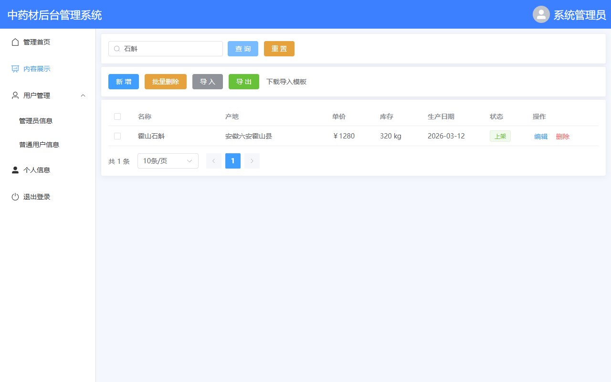
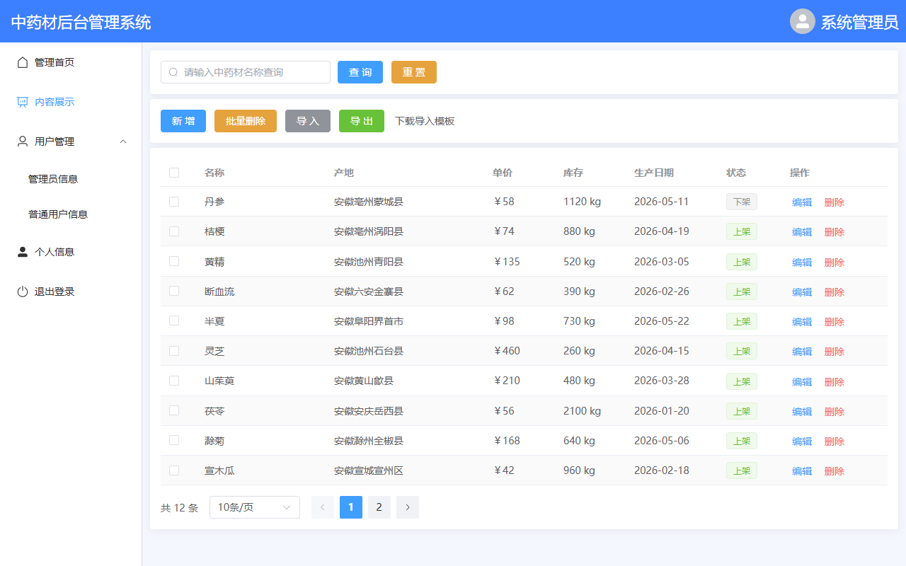
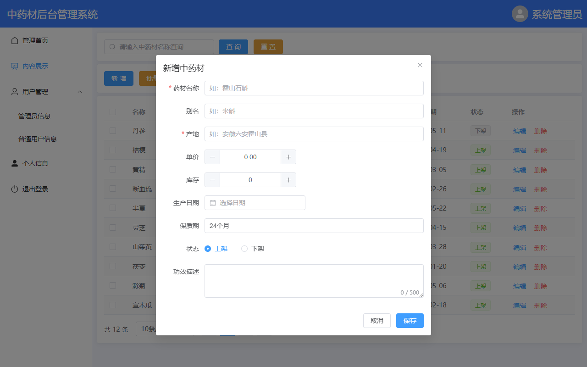
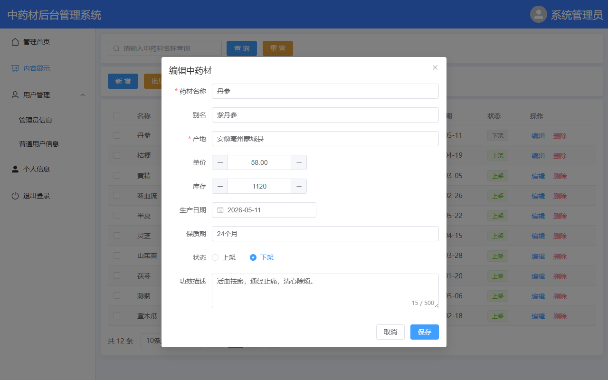
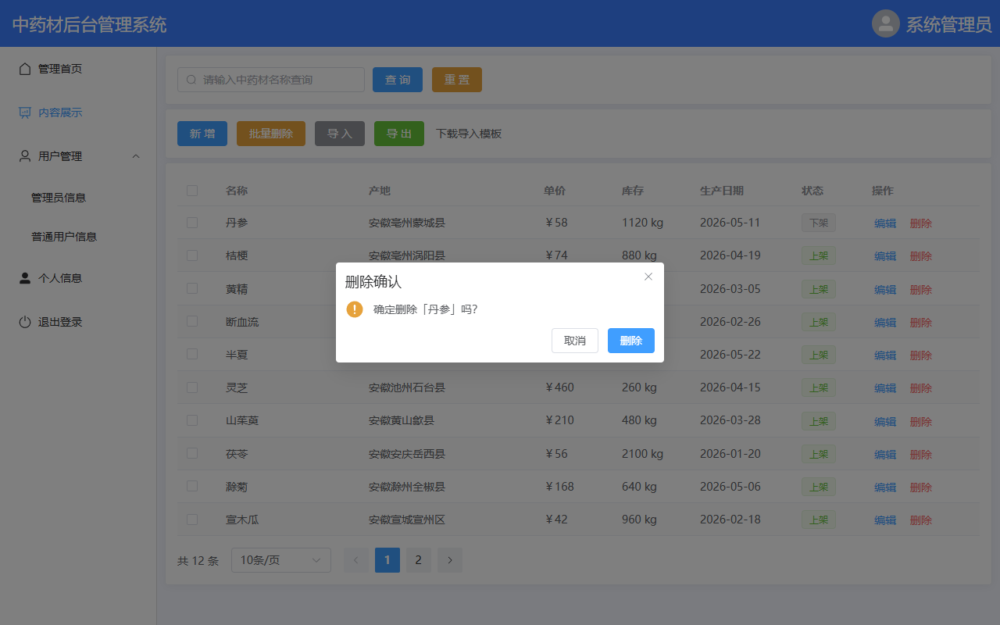
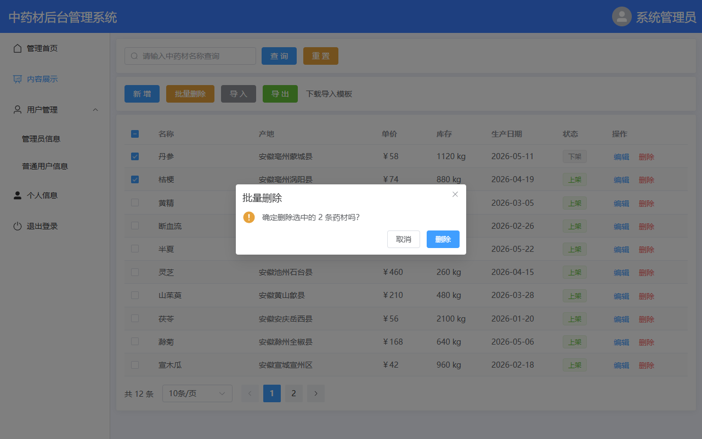
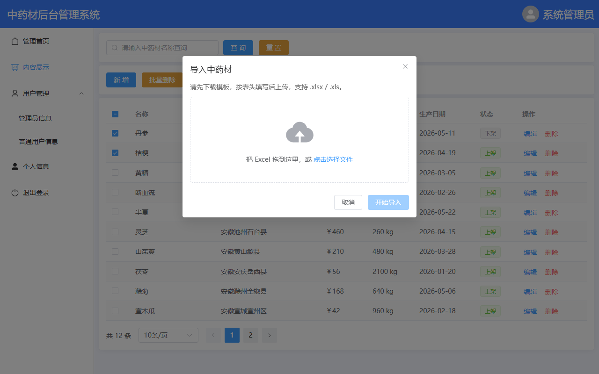
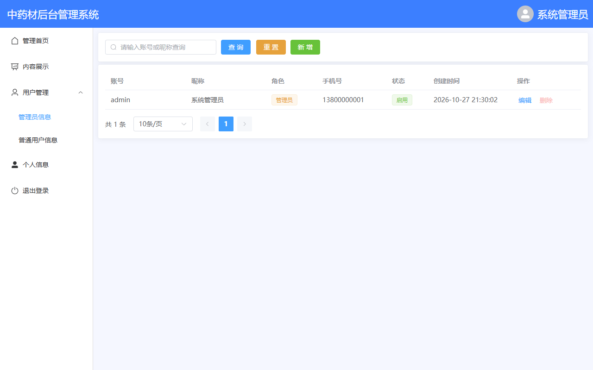
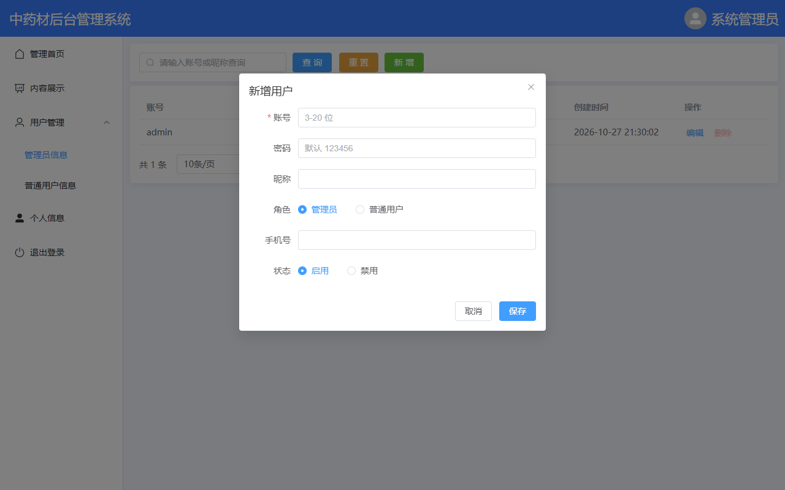

# 实训8 中药材管理系统 开发文档（前端 + 后端）

> 项目位置：`D:\course\Javaweb\实训8_中药材管理系统`
>
> 前端以老师 `实训6_后台管理页面\工程\admin-layout` 的原版页面为准（`实训7` 里的 `vue` 是它的副本，但 `Manage.vue` 被替换成了个人姓名/学号，本项目不采用那一版）：`Manage.vue` 的蓝色顶栏、左侧菜单，`Detail.vue` 的“查询 / 新增 / 批量删除 / 导入 / 导出 / 表格 / 分页”卡片结构和按钮文字都保留；表格列按数据库字段从 3 列扩展为 7 列，按钮背后的假数据换成了 SpringBoot + MyBatis + MySQL 的真实接口。
>
> 后端包名、`Result`、`GlobalExceptionHandler`、`application.yml` 的写法也按老师讲义来：`com.example`、`springboot`、数据库 `xm-pro`。

---

## 目录

1. [项目说明与功能清单](#1-项目说明与功能清单)
2. [最终效果截图](#2-最终效果截图)
3. [项目结构](#3-项目结构)
4. [数据库设计](#4-数据库设计)
5. [后端开发步骤](#5-后端开发步骤)
6. [接口文档](#6-接口文档)
7. [前端开发步骤](#7-前端开发步骤)
8. [运行步骤](#8-运行步骤)
9. [功能验收（逐项截图）](#9-功能验收逐项截图)
10. [联调常见问题](#10-联调常见问题)
11. [与老师讲义/前端的对应说明](#11-与老师讲义前端的对应说明)
12. [后续可扩展](#12-后续可扩展)

---

## 1. 项目说明与功能清单

### 1.1 这个项目做了什么

老师实训7 的讲义讲到：新建 SpringBoot 工程、配置数据库、写第一个接口、用 `Result` 统一返回、用 `GlobalExceptionHandler` 统一异常。讲义到“全局异常”就结束了。

本项目在讲义的基础上继续往下做，把老师前端 `内容展示` 页上的按钮全部接上真实后端：

| 编号 | 功能 | 说明 |
|---|---|---|
| 1 | 条件查询 | 按中药材名称模糊查询 |
| 2 | 分页 | 页码、每页条数、总数，后端 `limit` 实现 |
| 3 | 新增 | 弹窗填写药材信息，保存到 MySQL |
| 4 | 编辑 | 回显当前行数据，修改后保存 |
| 5 | 单条删除 | 删除前二次确认 |
| 6 | 批量删除 | 勾选多行，一次删除 |
| 7 | Excel 导入 | 下载模板 → 填写 → 上传，批量入库 |
| 8 | Excel 导出 | 按当前查询条件导出 `.xlsx` |
| 9 | 模板下载 | 导出带表头和填写说明的模板 |
| 10 | 用户管理 | 管理员信息 / 普通用户信息列表、新增、编辑、删除 |

> 老师原工程里的“商品列表 / 订单列表”本来就是占位页（只有一行文字），本次没有业务需求，保持原样，没有改动。

### 1.2 技术栈

| 层次 | 技术 | 版本 |
|---|---|---|
| JDK | Java | 21 |
| 后端框架 | Spring Boot | 3.5.16 |
| 持久层 | MyBatis Spring Boot Starter | 3.0.5 |
| 数据库 | MySQL | 8.0.43 |
| Excel | Apache POI（poi-ooxml） | 5.3.0 |
| 前端框架 | Vue | 3.5.x |
| UI 组件 | Element Plus | 2.14.x |
| 路由 | Vue Router | 5.x |
| 请求库 | axios | 1.x |
| 构建 | Maven 3.8 / Vite 7 | — |

### 1.3 与老师讲义的对照

| 讲义内容 | 本项目做法 |
|---|---|
| 创建 SpringBoot3 工程，Group `com.example`，Artifact `springboot` | 完全一致 |
| 三个依赖：Spring Web、MyBatis、MySQL Driver | 保留，另加 `spring-boot-starter-validation` 和 POI |
| `application.yml` 配 `xm-pro` 数据库 | 一致，`url` 指向 `jdbc:mysql://localhost:3306/xm-pro` |
| 统一返回 `Result`（code / msg / data） | 一致，字段名是 `msg`（讲义正文写 message，代码里是 msg，以代码为准） |
| `GlobalExceptionHandler` + `CustomException` | 一致，另补充了参数校验、404、重复键、Excel 等异常 |
| 讲义没有讲 CRUD、前端联调 | 本项目继续补齐：实体 → Mapper → Service → Controller → axios → 页面 |

---

## 2. 最终效果截图

### 2.1 后台管理页面


---

## 3. 项目结构

```text
实训8_中药材管理系统
├─ db
│  └─ init.sql                      # 建库、建表、初始化 12 条药材和 2 个用户
├─ springboot                      # 后端（Maven 工程）
│  ├─ pom.xml
│  └─ src/main
│     ├─ java/com/example
│     │  ├─ SpringbootApplication.java
│     │  ├─ common
│     │  │  ├─ Result.java          # 统一返回
│     │  │  ├─ PageResult.java      # 分页结构
│     │  │  └─ CustomException.java # 自定义业务异常
│     │  ├─ config
│     │  │  └─ WebConfig.java       # UTF-8 + 跨域
│     │  ├─ controller
│     │  │  ├─ HerbController.java
│     │  │  └─ SysUserController.java
│     │  ├─ dto
│     │  │  ├─ HerbQuery.java
│     │  │  ├─ UserQuery.java
│     │  │  └─ UserDTO.java
│     │  ├─ entity
│     │  │  ├─ Herb.java
│     │  │  └─ SysUser.java
│     │  ├─ exception
│     │  │  └─ GlobalExceptionHandler.java
│     │  ├─ mapper
│     │  │  ├─ HerbMapper.java
│     │  │  └─ SysUserMapper.java
│     │  ├─ service
│     │  │  ├─ HerbService.java
│     │  │  └─ SysUserService.java
│     │  └─ util
│     │     ├─ ExcelUtil.java
│     │     └─ PasswordUtil.java
│     └─ resources
│        └─ application.yml
├─ vue                             # 前端（老师的工程 + axios）
│  ├─ package.json
│  ├─ vite.config.js               # /api 代理到 8080
│  └─ src
│     ├─ api
│     │  ├─ request.js             # axios 封装
│     │  ├─ herb.js
│     │  └─ user.js
│     ├─ router/index.js
│     ├─ views
│     │  ├─ Manage.vue             # 老师原版后台布局（未改样式）
│     │  ├─ Detail.vue             # 内容展示（已接真实接口）
│     │  ├─ User.vue               # 用户列表（老师原版是占位页）
│     │  └─ Home.vue / Goods.vue / Orders.vue / Test.vue
│     └─ utils/download.js         # 文件下载
└─ docs
   ├─ images/                      # 本文档所有截图
   └─ 实训8_中药材管理系统_开发文档.md
```

---

## 4. 数据库设计

### 4.1 建库

老师讲义里数据库叫 `xm-pro`（带横线）。MySQL 里带横线的库名在 SQL 中必须用反引号包起来：

```sql
CREATE DATABASE `xm-pro` DEFAULT CHARACTER SET utf8mb4 COLLATE utf8mb4_general_ci;
USE `xm-pro`;
```

> JDBC 连接串里不需要反引号，直接写 `jdbc:mysql://localhost:3306/xm-pro` 即可。

建库脚本在 `db/init.sql`，执行方式：

```powershell
mysql -uroot -p123456 --default-character-set=utf8mb4 < "D:\course\Javaweb\实训8_中药材管理系统\db\init.sql"
```

### 4.2 `herb` 中药材表

| 字段 | 类型 | 说明 |
|---|---|---|
| id | BIGINT | 主键，自增 |
| name | VARCHAR(50) | 药材名称，唯一 |
| alias | VARCHAR(50) | 别名 |
| origin | VARCHAR(100) | 产地 |
| price | DECIMAL(10,2) | 单价（元/公斤） |
| stock | INT | 库存（公斤） |
| produce_date | DATE | 生产日期 |
| shelf_life | VARCHAR(20) | 保质期 |
| description | VARCHAR(500) | 功效描述 |
| status | TINYINT | 1 上架，0 下架 |
| create_time | DATETIME | 创建时间 |
| update_time | DATETIME | 更新时间 |

建表 SQL：

```sql
CREATE TABLE herb (
    id            BIGINT       PRIMARY KEY AUTO_INCREMENT COMMENT '主键',
    name          VARCHAR(50)  NOT NULL                   COMMENT '药材名称',
    alias         VARCHAR(50)  DEFAULT NULL               COMMENT '别名',
    origin        VARCHAR(100) DEFAULT NULL               COMMENT '产地',
    price         DECIMAL(10,2) DEFAULT 0.00              COMMENT '单价（元/公斤）',
    stock         INT          DEFAULT 0                  COMMENT '库存（公斤）',
    produce_date  DATE         DEFAULT NULL               COMMENT '生产日期',
    shelf_life    VARCHAR(20)  DEFAULT '24个月'            COMMENT '保质期',
    description   VARCHAR(500) DEFAULT NULL               COMMENT '功效描述',
    status        TINYINT      DEFAULT 1                  COMMENT '状态：1上架 0下架',
    create_time   DATETIME     DEFAULT CURRENT_TIMESTAMP  COMMENT '创建时间',
    update_time   DATETIME     DEFAULT CURRENT_TIMESTAMP ON UPDATE CURRENT_TIMESTAMP COMMENT '更新时间',
    UNIQUE KEY uk_herb_name (name)
) ENGINE = InnoDB DEFAULT CHARSET = utf8mb4 COMMENT = '中药材信息表';
```

### 4.3 `sys_user` 用户表

| 字段 | 类型 | 说明 |
|---|---|---|
| id | BIGINT | 主键 |
| username | VARCHAR(50) | 登录账号，唯一 |
| password | CHAR(64) | SHA-256 摘要 |
| nickname | VARCHAR(50) | 昵称 |
| role | VARCHAR(20) | ADMIN / USER |
| phone | VARCHAR(20) | 手机号 |
| status | TINYINT | 1 启用，0 禁用 |
| create_time | DATETIME | 创建时间 |

初始化数据：`admin / 123456`（管理员）、`user / 123456`（普通用户）。密码存的是 `SHA-256("123456")`：

```text
8d969eef6ecad3c29a3a629280e686cf0c3f5d5a86aff3ca12020c923adc6c92
```

> 教学项目为了少引依赖用 SHA-256；生产环境应使用 BCrypt 加盐。

---

## 5. 后端开发步骤

### 5.1 创建工程（按讲义）

IDEA → New Project → Spring Initializr：

| 项 | 值 |
|---|---|
| Group | `com.example` |
| Artifact | `springboot` |
| Type | Maven |
| Language | Java |
| JDK | 21 |
| Packaging | Jar |

依赖勾选：

- Spring Web
- MyBatis Framework
- MySQL Driver

生成后删除不需要的测试类、`application.properties`，改成 `application.yml`。

### 5.2 `pom.xml`

在讲义三个依赖的基础上，加了参数校验和 POI：

```xml
<dependencies>
    <dependency>
        <groupId>org.springframework.boot</groupId>
        <artifactId>spring-boot-starter-web</artifactId>
    </dependency>
    <dependency>
        <groupId>org.springframework.boot</groupId>
        <artifactId>spring-boot-starter-validation</artifactId>
    </dependency>
    <dependency>
        <groupId>org.mybatis.spring.boot</groupId>
        <artifactId>mybatis-spring-boot-starter</artifactId>
        <version>3.0.5</version>
    </dependency>
    <dependency>
        <groupId>com.mysql</groupId>
        <artifactId>mysql-connector-j</artifactId>
        <scope>runtime</scope>
    </dependency>
    <dependency>
        <groupId>org.apache.poi</groupId>
        <artifactId>poi-ooxml</artifactId>
        <version>5.3.0</version>
    </dependency>
</dependencies>
```

### 5.3 `application.yml`

```yaml
server:
  port: 8080
  servlet:
    context-path: /api          # 所有接口统一加 /api 前缀
    encoding:
      charset: UTF-8
      force: true

spring:
  datasource:
    driver-class-name: com.mysql.cj.jdbc.Driver
    url: jdbc:mysql://localhost:3306/xm-pro?useUnicode=true&characterEncoding=utf-8&useSSL=false&serverTimezone=Asia/Shanghai&allowPublicKeyRetrieval=true
    username: root
    password: 123456
  servlet:
    multipart:
      max-file-size: 10MB       # Excel 导入文件大小限制
      max-request-size: 20MB
  jackson:
    time-zone: Asia/Shanghai
    date-format: yyyy-MM-dd HH:mm:ss

mybatis:
  configuration:
    map-underscore-to-camel-case: true   # produce_date -> produceDate
    log-impl: org.apache.ibatis.logging.stdout.StdOutImpl
```

`context-path: /api` 的作用：后端接口实际地址是 `http://localhost:8080/api/herb/page`。前端只要把 axios 的 `baseURL` 设成 `/api`，Vite 代理把 `/api` 原样转给 8080，不需要 `rewrite`。

### 5.4 启动类

```java
@SpringBootApplication
@MapperScan("com.example.mapper")
public class SpringbootApplication {
    public static void main(String[] args) {
        SpringApplication.run(SpringbootApplication.class, args);
    }
}
```

`@MapperScan` 告诉 MyBatis 去 `com.example.mapper` 包下找 Mapper 接口，这样每个 Mapper 上不写 `@Mapper` 也能被扫描到。

### 5.5 统一返回 `Result`（按讲义）

```java
public class Result {
    private String code;   // 200 成功、500 系统异常、400 业务异常
    private String msg;
    private Object data;

    public static Result success() { ... }
    public static Result success(Object data) { ... }
    public static Result error() { ... }
    public static Result error(String code, String msg) { ... }
}
```

使用示例：

```java
return Result.success(herbService.page(query));
return Result.success("新增成功", null);
return Result.error("400", "药材名称不能为空");
```

### 5.6 全局异常（按讲义）

`exception/GlobalExceptionHandler.java`：

```java
@RestControllerAdvice
public class GlobalExceptionHandler {

    @ExceptionHandler(CustomException.class)
    public Result handleCustomException(CustomException e) {
        return Result.error(e.getCode(), e.getMessage());
    }

    @ExceptionHandler(MethodArgumentNotValidException.class)
    public Result handleValid(MethodArgumentNotValidException e) {
        FieldError error = e.getBindingResult().getFieldError();
        return Result.error("400", error == null ? "参数校验失败" : error.getDefaultMessage());
    }

    @ExceptionHandler(Exception.class)
    public Result handleException(Exception e) {
        log.error("系统异常：{}", e.getMessage(), e);
        return Result.error();
    }
}
```

`CustomException` 继承 `RuntimeException`，业务代码里这样抛：

```java
throw new CustomException("400", "药材不存在或已被删除");
```

### 5.7 跨域配置 `WebConfig`

老师前端跑在 `5173`，后端在 `8080`，属于跨域。除了 Vite 代理，后端也加了 CORS 兜底：

```java
@Override
public void addCorsMappings(CorsRegistry registry) {
    registry.addMapping("/**")
            .allowedOriginPatterns("*")
            .allowedMethods("GET", "POST", "PUT", "DELETE", "OPTIONS")
            .allowedHeaders("*")
            .exposedHeaders("Content-Disposition");
}
```

> 两种方式二选一即可：开发时用 Vite 的 `server.proxy` 最省事；如果前端直接写 `http://localhost:8080`，后端这段 CORS 就必需。

### 5.8 实体类

`entity/Herb.java` 的字段和 `herb` 表一一对应，并用注解做参数校验：

```java
public class Herb {
    private Long id;

    @NotBlank(message = "药材名称不能为空")
    private String name;

    private String alias;
    private String origin;

    @DecimalMin(value = "0", message = "价格不能为负数")
    private BigDecimal price;

    @Min(value = 0, message = "库存不能为负数")
    private Integer stock;

    @JsonFormat(pattern = "yyyy-MM-dd")
    private LocalDate produceDate;

    private String shelfLife;
    private String description;
    private Integer status;

    @JsonFormat(pattern = "yyyy-MM-dd HH:mm:ss")
    private LocalDateTime createTime;
    private LocalDateTime updateTime;

    // getter / setter 省略
}
```

`application.yml` 里的 `map-underscore-to-camel-case: true` 会自动把 `produce_date` 映射到 `produceDate`。

### 5.9 Mapper（MyBatis 注解 SQL）

以分页查询为例，`HerbMapper.java`：

```java
@Select("""
        <script>
        select * from herb
        <where>
            <if test="q.name != null and q.name != ''">
                and name like concat('%', #{q.name}, '%')
            </if>
            <if test="q.origin != null and q.origin != ''">
                and origin like concat('%', #{q.origin}, '%')
            </if>
            <if test="q.status != null">
                and status = #{q.status}
            </if>
        </where>
        order by id desc
        limit #{offset}, #{q.pageSize}
        </script>
        """)
List<Herb> selectPage(@Param("q") HerbQuery query, @Param("offset") int offset);
```

几个关键点：

- `<script>` + `<if>` 实现动态 SQL：没填名称就不拼 `name like`；
- `limit #{offset}, #{q.pageSize}` 实现分页；
- `offset = (pageNum - 1) * pageSize` 在 Service 里算；
- 新增用 `@Options(useGeneratedKeys = true, keyProperty = "id")` 回填主键；
- 批量删除用 `<foreach>` 拼 `id in (...)`；
- 批量导入用 `insert ignore`，重复名称自动跳过。

### 5.10 Service

`HerbService.page()`：

```java
public PageResult<Herb> page(HerbQuery query) {
    // 页码、每页条数兜底
    if (query.getPageNum() == null || query.getPageNum() < 1) query.setPageNum(1);
    if (query.getPageSize() == null || query.getPageSize() < 1) query.setPageSize(10);

    long total = herbMapper.count(query);
    List<Herb> records = herbMapper.selectPage(
            query, (query.getPageNum() - 1) * query.getPageSize());
    return new PageResult<>(total, records);
}
```

`PageResult` 返回给前端就是：

```json
{
  "total": 12,
  "records": [ { "id": 1, "name": "霍山石斛", "...": "..." } ]
}
```

### 5.11 Controller

`HerbController` 的接口一览：

| 方法 | 路径 | 作用 |
|---|---|---|
| GET | `/herb/page` | 分页 + 条件查询 |
| GET | `/herb/{id}` | 查详情 |
| POST | `/herb` | 新增 |
| PUT | `/herb` | 修改 |
| DELETE | `/herb/{id}` | 删除单条 |
| DELETE | `/herb/batch` | 批量删除 |
| POST | `/herb/import` | Excel 导入 |
| GET | `/herb/export` | Excel 导出 |
| GET | `/herb/template` | 下载导入模板 |

因为配置了 `context-path: /api`，浏览器实际访问地址要加 `/api`：

```text
http://localhost:8080/api/herb/page?pageNum=1&pageSize=10
```

### 5.12 Excel 导入导出

`util/ExcelUtil.java` 用 Apache POI 实现：

- 导出：`XSSFWorkbook` 创建表头（深绿底、白字、加粗），逐行写药材，设置列宽、冻结首行；
- 导入：`WorkbookFactory.create(file.getInputStream())` 读取第一个 Sheet，跳过表头，逐行转 `Herb`；
- 日期单元格同时兼容 Excel 日期格式和 `yyyy-MM-dd` 字符串；
- 导入时 `name` 为空的行直接跳过；
- 文件名用 `URLEncoder.encode(..., UTF_8)`，避免中文文件名乱码。

模板表头：

```text
名称 | 别名 | 产地 | 价格(元/公斤) | 库存(公斤) | 生产日期(yyyy-MM-dd) | 保质期 | 功效描述 | 状态(上架/下架)
```

---

## 6. 接口文档

统一返回格式：

```json
{ "code": "200", "msg": "请求成功", "data": { } }
```

`code` 是**业务状态码**，不是 HTTP 状态码；即使业务报错，HTTP 仍然是 200。前端判断成功要看 `res.data.code === '200'`。

### 6.1 药材分页查询

```http
GET /api/herb/page?pageNum=1&pageSize=10&name=石斛
```

返回：

```json
{
  "code": "200",
  "msg": "请求成功",
  "data": {
    "total": 1,
    "records": [
      {
        "id": 1,
        "name": "霍山石斛",
        "alias": "米斛",
        "origin": "安徽六安霍山县",
        "price": 1280.00,
        "stock": 320,
        "produceDate": "2026-03-12",
        "shelfLife": "24个月",
        "description": "益胃生津，滋阴清热。用于热病津伤、口干烦渴。",
        "status": 1,
        "createTime": "2026-10-27 21:30:02"
      }
    ]
  }
}
```

### 6.2 新增

```http
POST /api/herb
Content-Type: application/json

{
  "name": "凤丹皮",
  "alias": "牡丹皮",
  "origin": "安徽铜陵凤凰山",
  "price": 150.00,
  "stock": 600,
  "produceDate": "2026-07-01",
  "shelfLife": "24个月",
  "description": "清热凉血，活血化瘀。",
  "status": 1
}
```

返回：

```json
{ "code": "200", "msg": "新增成功", "data": null }
```

### 6.3 修改 / 删除 / 批量删除

```http
PUT    /api/herb
DELETE /api/herb/{id}
DELETE /api/herb/batch      body: [1, 2, 3]
```

### 6.4 导入 / 导出

```http
POST /api/herb/import       form-data: file=xxx.xlsx
GET  /api/herb/export?name=石斛
GET  /api/herb/template
```

导出和模板返回的是文件流，响应头：

```text
Content-Type: application/vnd.openxmlformats-officedocument.spreadsheetml.sheet
Content-Disposition: attachment; filename*=UTF-8''...
```

### 6.5 用户管理

```http
GET    /api/user/page?pageNum=1&pageSize=10&role=ADMIN
POST   /api/user
PUT    /api/user
DELETE /api/user/{id}
PUT    /api/user/{id}/status?status=0
```

---

## 7. 前端开发步骤

### 7.1 直接使用老师的工程

把老师 `实训6_后台管理页面\工程\admin-layout` 的原版页面复制到本项目的 `vue` 目录（`Manage.vue`、`Home.vue`、`Test.vue`、`global.css` 原样保留；`Detail.vue` 沿用同一套卡片结构接入真实接口），保留：

- `src/views/Manage.vue`：蓝色顶栏、左侧菜单、`<router-view>`；
- `src/views/Detail.vue`：查询卡片、按钮卡片、表格卡片、分页；
- `src/router/index.js`：按老师实训6 的写法，`/manage` 父路由下放 `detail/user/goods/orders`，访问 `/manage` 默认重定向到 `/manage/detail`；管理员/普通用户分别走 `/manage/admin`、`/manage/staff`；
- `src/assets/global.css`、`main.js` 原样。

**样式没有改**：顶栏还是 `#3c7fff`，菜单宽度 220px，卡片还是白底 + `1px solid #ebeef5` + `box-shadow`。只是把 `Detail.vue` 里的模拟数据换成了接口数据。

### 7.2 安装 axios 并配置代理

```powershell
cd "D:\course\Javaweb\实训8_中药材管理系统\vue"
npm install
```

`vite.config.js`：

```js
export default defineConfig({
  plugins: [vue()],
  resolve: {
    alias: { '@': fileURLToPath(new URL('./src', import.meta.url)) }
  },
  server: {
    port: 5173,
    proxy: {
      '/api': {
        target: 'http://localhost:8080',
        changeOrigin: true
      }
    }
  }
})
```

前端请求 `/api/herb/page` → Vite 转发到 `http://localhost:8080/api/herb/page`。

### 7.3 axios 封装

`src/api/request.js`：

```js
const service = axios.create({
  baseURL: '/api',
  timeout: 15000
})

service.interceptors.response.use((response) => {
  if (response.config.responseType === 'blob') return response

  const res = response.data
  if (res.code === '200') return res

  ElMessage.error(res.msg || '操作失败')
  return Promise.reject(new Error(res.msg || '操作失败'))
})
```

好处：页面里不用每次都写 `if (res.code === '200')`，成功直接拿 `res.data`，失败自动弹提示。

### 7.4 接口函数

`src/api/herb.js`：

```js
export const getHerbPage = (params) => request.get('/herb/page', { params })
export const addHerb = (data) => request.post('/herb', data)
export const updateHerb = (data) => request.put('/herb', data)
export const deleteHerb = (id) => request.delete(`/herb/${id}`)
export const deleteHerbBatch = (ids) => request.delete('/herb/batch', { data: ids })
export const importHerb = (formData) => request.post('/herb/import', formData)
export const exportHerb = (params) =>
  request.get('/herb/export', { params, responseType: 'blob' })
export const downloadTemplate = () =>
  request.get('/herb/template', { responseType: 'blob' })
```

### 7.5 `Detail.vue` 改造点

**改之前**（老师原版）是写死的 9 条数据：

```js
const data = reactive({
  name: null,
  tableData: [
    { id: 1, name: '霍山石斛', address: '安徽六安霍山县', date: '2027-10-11' },
    // ...
  ],
  pageNum: 1,
  pageSize: 10,
  total: 50
})
```

**改之后**：

```js
const data = reactive({
  name: null,
  tableData: [],
  pageNum: 1,
  pageSize: 10,
  total: 0,
  loading: false,
  selection: []
})

const loadData = async () => {
  data.loading = true
  try {
    const res = await getHerbPage({
      pageNum: data.pageNum,
      pageSize: data.pageSize,
      name: data.name || undefined
    })
    data.tableData = res.data.records
    data.total = res.data.total
  } finally {
    data.loading = false
  }
}

onMounted(loadData)
```

这样：
- 表格数据来自 `/api/herb/page`；
- `total` 来自后端 count，分页条自动算总页数；
- 查询按钮调 `loadData()`，重置按钮清空条件再查。

**新增/编辑共用同一个弹窗**：

```js
const openAdd = () => {
  Object.assign(form, emptyForm())
  dialogVisible.value = true
}

const openEdit = (row) => {
  Object.assign(form, emptyForm(), row)
  dialogVisible.value = true
}

const save = async () => {
  await formRef.value.validate()
  if (form.id) {
    await updateHerb(form)
  } else {
    await addHerb(form)
  }
  dialogVisible.value = false
  loadData()
}
```

**删除/批量删除**用 `ElMessageBox.confirm` 二次确认，确认后调接口，再刷新列表。

**导出**：

```js
const exportData = async () => {
  const res = await exportHerb({
    pageNum: data.pageNum,
    pageSize: data.pageSize,
    name: data.name || undefined
  })
  await downloadBlob(res, '中药材数据.xlsx')
}
```

`utils/download.js` 从响应头 `Content-Disposition` 里解析中文文件名，创建 `<a download>` 触发浏览器下载。

**导入**：`el-upload` 设置 `:auto-upload="false"`，点“开始导入”时把 `file.raw` 放进 `FormData`，调用 `/herb/import`。

### 7.6 用户管理页

老师原工程的 `User.vue` 只有一行占位文字。本次按同样的“卡片 + 查询 + 表格 + 分页”结构补全：

- `/manage/admin` 对应管理员，`route.meta.role = 'ADMIN'`；
- `/manage/staff` 对应普通用户，`route.meta.role = 'USER'`；
- 两个菜单复用同一个 `User.vue`，查询时带 `role` 参数过滤；
- 新增/编辑/删除/启用禁用都走 `/api/user` 接口。

---

## 8. 运行步骤

### 8.1 启动 MySQL，执行建库脚本

```powershell
mysql -uroot -p123456 --default-character-set=utf8mb4 < "D:\course\Javaweb\实训8_中药材管理系统\db\init.sql"
```

确认数据：

```sql
USE `xm-pro`;
SELECT COUNT(*) FROM herb;      -- 12
SELECT id, username, role FROM sys_user;  -- admin / user
```

### 8.2 启动后端

方式一：IDEA 打开 `springboot`，运行 `SpringbootApplication`。

方式二：命令行：

```powershell
cd "D:\course\Javaweb\实训8_中药材管理系统\springboot"
mvn -B -DskipTests clean package
java -jar target\springboot-0.0.1-SNAPSHOT.jar
```

启动成功后控制台出现：

```text
Tomcat started on port 8080 (http) with context path '/api'
Started SpringbootApplication in ... seconds
```

浏览器验证：

```text
http://localhost:8080/api/herb/page?pageNum=1&pageSize=2
```

### 8.3 启动前端

```powershell
cd "D:\course\Javaweb\实训8_中药材管理系统\vue"
npm install
npm run dev
```

访问：

```text
http://localhost:5173/manage/detail
```

---

## 9. 功能验收（逐项截图）

| 功能 | 操作 | 预期结果 |
|---|---|---|
| 列表查询 | 进入“内容展示” | 显示数据库中的 12 条药材，分页 12 条 |
| 条件查询 | 输入“石斛”点查询 | 只显示霍山石斛 |
| 新增 | 点“新增”，填写后保存 | 列表多一条，提示“新增成功” |
| 编辑 | 点某行“编辑”，改库存后保存 | 该行库存更新 |
| 单条删除 | 点某行“删除” | 弹出确认框，确认后删除 |
| 批量删除 | 勾选两条，点“批量删除” | 提示删除数量，列表刷新 |
| Excel 导入 | 点“导入”，选模板文件 | 提示“成功导入 N 条” |
| Excel 导出 | 点“导出” | 浏览器下载 `中药材数据.xlsx` |
| 模板下载 | 点“下载导入模板” | 下载 `中药材导入模板.xlsx` |
| 用户列表 | 左侧“用户管理 → 管理员信息” | 只显示管理员账号 |
| 新增用户 | 点“新增” | 弹窗录入账号、角色 |

### 9.1 条件查询

输入“石斛”点击“查 询”，列表只剩霍山石斛，分页总数变成 1。



### 9.2 列表页



### 9.3 新增弹窗



### 9.4 编辑弹窗



### 9.5 删除确认



### 9.6 批量删除



### 9.7 导入弹窗



### 9.8 用户列表



### 9.9 新增用户



### 9.1 后端实测返回（curl）

```text
GET /api/herb/page?pageNum=1&pageSize=1
{"code":"200","msg":"请求成功","data":{"total":12,"records":[{"id":12,"name":"丹参",...}]}}
```

```text
POST /api/herb
{"code":"200","msg":"新增成功","data":null}
```

```text
POST /api/herb/import  （上传 `docs/examples/中药材导入-示例.xlsx`）
{"code":"200","msg":"成功导入 2 条数据","data":null}
```

### 9.2 异常测试

| 场景 | 请求 | 返回 |
|---|---|---|
| 名称为空 | POST `/api/herb` `{"name":""}` | `{"code":"400","msg":"药材名称不能为空"}` |
| 接口不存在 | GET `/api/nothing` | `{"code":"404","msg":"接口不存在：nothing"}` |
| JSON 格式错 | POST `/api/herb` `not-json` | `{"code":"400","msg":"请求参数格式错误..."}` |
| 重复名称 | 新增同名药材 | `{"code":"400","msg":"名称或账号已存在..."}` |

---

## 10. 联调常见问题

### 10.1 前端 404 / 空白

- 检查后端是否启动：`http://localhost:8080/api/herb/page`；
- 检查 `vite.config.js` 的 proxy 是否指向 `http://localhost:8080`；
- 检查后端 `context-path: /api` 和前端 `baseURL: '/api'` 是否重复或漏写。

### 10.2 跨域 `CORS policy`

两种解法：

1. 用 Vite 代理（本项目默认，推荐）；
2. 后端 `WebConfig.addCorsMappings` 放行前端地址。

### 10.3 中文乱码

- 数据库、表、连接串都用 `utf8mb4`；
- `WebConfig` 把 `StringHttpMessageConverter` 和 Jackson 都设成 UTF-8；
- Excel 文件名用 `URLEncoder.encode(..., UTF_8)`。

### 10.4 `Table 'xm-pro.herb' doesn't exist`

没执行 `db/init.sql`，或者执行到了别的库。检查：

```sql
SHOW DATABASES LIKE 'xm-pro';
USE `xm-pro`;
SHOW TABLES;
```

### 10.5 库名带横线

`xm-pro` 在 SQL 里必须写反引号：`` `xm-pro` ``。JDBC URL 里直接写 `xm-pro`，不要加反引号。

### 10.6 日期显示带 `T`

`LocalDateTime` 默认会序列化成 `2026-10-27T21:30:02`。本项目在实体字段上加了：

```java
@JsonFormat(pattern = "yyyy-MM-dd HH:mm:ss")
```

所以返回 `2026-10-27 21:30:02`。

### 10.7 导出文件打不开 / 文件名乱码

- 响应必须是 `application/vnd.openxmlformats-officedocument.spreadsheetml.sheet`；
- 文件名用 `filename*=UTF-8''` 编码；
- 前端 axios 必须设置 `responseType: 'blob'`。

---

## 11. 与老师讲义/前端的对应说明

1. **前端没有重新设计**：`Manage.vue`、`Detail.vue` 的模板结构、颜色、间距、按钮文字（“查 询”“重 置”“新 增”“批量删除”“导 入”“导 出”）都保留老师原样；为了显示单价、库存、状态，表格列在原“名称/地址/日期”基础上做了必要扩展。
2. **只改了数据来源**：`Detail.vue` 的 `tableData` 从写死的 9 条，改成 `getHerbPage()` 返回的 `records`；`total` 从写死的 50，改成后端返回的真实条数。
3. **后端按讲义命名**：`com.example`、`SpringbootApplication`、`common.Result`、`exception.GlobalExceptionHandler`、`common.CustomException`、数据库 `xm-pro`。
4. **讲义没讲的部分**：MyBatis 的 Mapper/Service/Controller 分层、Excel 导入导出、前端 axios 联调，是在讲义基础上补的，代码注释里都写了对应说明。
5. **没有加登录页**：老师前端没有登录页，本项目也没有加，避免改变老师的前端结构；后端接口直接可用。如果后续要加登录，再在 `WebConfig` 里加拦截器即可。

---

## 12. 后续可扩展

- 登录 / JWT / 角色权限（管理员才能进用户管理）；
- 图片上传（药材图片字段已预留）；
- 多条件查询（产地、状态、价格区间）；
- 导出时按当前页 / 全部数据切换；
- 首页统计图表（药材总数、库存、产区分布）；
- 操作日志、数据备份。

---

## 附录 A：常用命令

```powershell
# 建库
mysql -uroot -p123456 --default-character-set=utf8mb4 < "D:\course\Javaweb\实训8_中药材管理系统\db\init.sql"

# 后端打包
cd "D:\course\Javaweb\实训8_中药材管理系统\springboot"
mvn -B -DskipTests clean package

# 启动后端
java -jar target\springboot-0.0.1-SNAPSHOT.jar

# 前端
cd "D:\course\Javaweb\实训8_中药材管理系统\vue"
npm install
npm run dev
```

## 附录 B：默认账号

| 账号 | 密码 | 角色 |
|---|---|---|
| admin | 123456 | 管理员 |
| user | 123456 | 普通用户 |

> 密码在数据库里是 SHA-256 摘要，不是明文。

---

**文档结束。**
